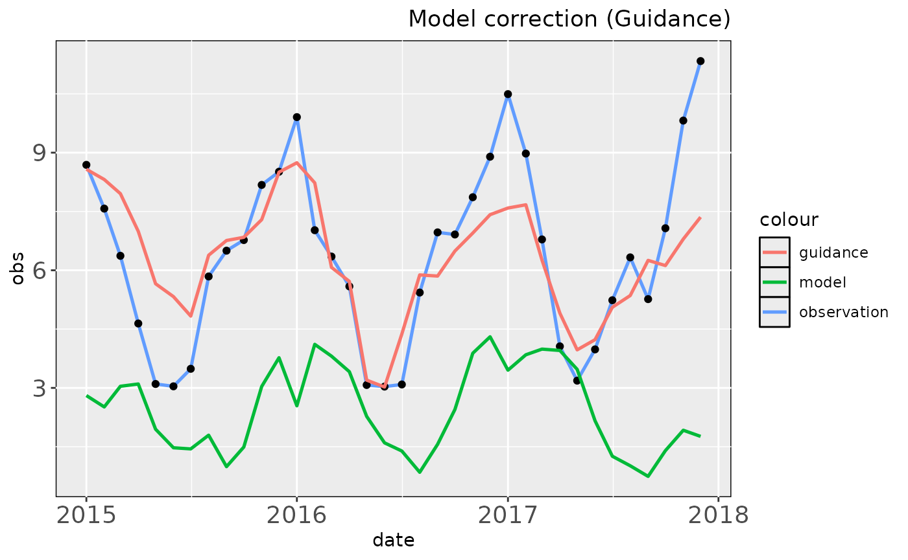

# Multiple-Linear-Regression-Correction

First the package should be loaded:

``` r

library(aws.wrfsmn)
```

The example data to use will be ‘eva’ and should be call it with data:

``` r

head(eva)
#>                 Dates evapo_obs OUT_PREC OUT_EVAP OUT_RUNOFF OUT_BASEFLOW
#> 1 2015-01-01 03:00:00       7.5    2.829   1.6771     0.3699       0.0017
#> 2 2015-01-02 03:00:00      10.5    0.065   1.2188     0.0000       0.0017
#> 3 2015-01-03 03:00:00       6.8    0.000   1.4352     0.0000       0.0017
#> 4 2015-01-04 03:00:00       6.7    1.107   1.3349     0.1247       0.0017
#> 5 2015-01-05 03:00:00       6.6    0.165   1.8848     0.0000       0.0017
#> 6 2015-01-06 03:00:00      11.1    0.000   1.7053     0.0000       0.0017
#>   OUT_SOIL_MOIST_lyr_1 OUT_EVAP_CANOP OUT_SURF_TEMP
#> 1              25.2455         0.0000       29.8297
#> 2              24.8014         0.2505       22.5682
#> 3              24.2769         0.0000       25.3413
#> 4              24.5836         0.0000       27.9340
#> 5              24.0370         0.3505       29.7361
#> 6              23.4706         0.0000       31.6070
```

A Multiple Linear Regression is made between the predictand (observed
evaporation) and the following predictors:

``` r

test.predictors <- c('OUT_PREC',
                     'OUT_EVAP',
                     'OUT_RUNOFF',
                     'OUT_BASEFLOW',
                     'OUT_SOIL_MOIST_lyr_1',
                     'OUT_EVAP_CANOP',
                     'OUT_SURF_TEMP')
```

Using multiple.guidance function to obtain the regression coefficients:

``` r

mg <- multiple.guidance(input.data = eva, predictand = 'evapo_obs', predictors = test.predictors)
mg
#> 
#> Call:
#> lm(formula = as.formula(paste0(predictand, " ~ ", paste(predictors, 
#>     collapse = "+"))), data = input.data)
#> 
#> Coefficients:
#>          (Intercept)              OUT_PREC              OUT_EVAP  
#>              2.71672              -0.02898               0.39361  
#>           OUT_RUNOFF          OUT_BASEFLOW  OUT_SOIL_MOIST_lyr_1  
#>              0.38710            -888.62775              -0.10827  
#>       OUT_EVAP_CANOP         OUT_SURF_TEMP  
#>             -0.05162               0.32948
```

The evaluation of the correction applied from the mg regression is:

``` r

evaluation.eva <- mg.evaluation(input.data = eva, predictand = 'evapo_obs', predictors = test.predictors, var.model = 'OUT_EVAP', lmodel = mg)

head(evaluation.eva)
#> [[1]]
#>      Dates                 observation model     guidance           
#> 1    "2015-01-01 03:00:00" "7.5"       "1.6771"  "9.02231246845423" 
#> 2    "2015-01-02 03:00:00" "10.5"      "1.2188"  "6.42148880224699" 
#> 3    "2015-01-03 03:00:00" "6.8"       "1.4352"  "7.49194236342985" 
#> 4    "2015-01-04 03:00:00" "6.7"       "1.3349"  "8.28968257496761" 
#> 5    "2015-01-05 03:00:00" "6.6"       "1.8848"  "9.11999714399498" 
#> 6    "2015-01-06 03:00:00" "11.1"      "1.7053"  "9.74996281027777" 
#> 7    "2015-01-07 03:00:00" "11.9"      "1.3531"  "8.41880283556363" 
#> 8    "2015-01-08 03:00:00" "6.9"       "6.3858"  "9.71212610683116" 
#> 9    "2015-01-09 03:00:00" "8"         "1.6457"  "9.36871643692524" 
#> 10   "2015-01-10 03:00:00" "12.1"      "1.6724"  "10.0312577304694" 
#> 11   "2015-01-11 03:00:00" "12.9"      "1.4361"  "8.51127014572082" 
#> 12   "2015-01-12 03:00:00" "9"         "1.8557"  "9.61517054910394" 
#> 13   "2015-01-13 03:00:00" "12"        "1.4518"  "9.73718158490413" 
#> 14   "2015-01-14 03:00:00" "14.2"      "7.3252"  "10.1052954003839" 
#> 15   "2015-01-15 03:00:00" "3.8"       "0.6345"  "6.68184168772327" 
#> 16   "2015-01-16 03:00:00" "5"         "2.3799"  "7.83748635269391" 
#> 17   "2015-01-17 03:00:00" "6"         "1.4344"  "8.23876633925107" 
#> 18   "2015-01-18 03:00:00" "10"        "1.6368"  "8.13937191663511" 
#> 19   "2015-01-19 03:00:00" "6.8"       "1.5833"  "9.0945651322425"  
#> 20   "2015-01-20 03:00:00" NA          "9.5731"  "9.39552317576035" 
#> 21   "2015-01-21 03:00:00" NA          "1.7505"  "7.19051735685519" 
#> 22   "2015-01-22 03:00:00" "6.8"       "2.1046"  "7.58334323610683" 
#> 23   "2015-01-23 03:00:00" "7"         "2.3666"  "8.30262381871014" 
#> 24   "2015-01-24 03:00:00" "10"        "2.077"   "8.32165628913704" 
#> 25   "2015-01-25 03:00:00" "8"         "2.5189"  "8.32241125080757" 
#> 26   "2015-01-26 03:00:00" "8"         "2.2365"  "8.6052423385784"  
#> 27   "2015-01-27 03:00:00" "11.1"      "2.0111"  "8.70181394961932" 
#> 28   "2015-01-28 03:00:00" "9.9"       "14.1116" "12.452877564168"  
#> 29   "2015-01-29 03:00:00" NA          "2.8613"  "7.3183565459794"  
#> 30   "2015-01-30 03:00:00" NA          "2.5494"  "6.93056102430575" 
#> 31   "2015-01-31 03:00:00" "6"         "2.7442"  "7.16589654239483" 
#> 32   "2015-02-01 03:00:00" "9"         "2.9421"  "8.68398240759318" 
#> 33   "2015-02-02 03:00:00" "9"         "2.5775"  "9.3829580384175"  
#> 34   "2015-02-03 03:00:00" "8.9"       "2.5102"  "8.40687324682932" 
#> 35   "2015-02-04 03:00:00" "7"         "2.8289"  "9.01602300681138" 
#> 36   "2015-02-05 03:00:00" "6.9"       "2.3193"  "8.63823243528362" 
#> 37   "2015-02-06 03:00:00" "7"         "2.7375"  "8.67932942736626" 
#> 38   "2015-02-07 03:00:00" "12.5"      "2.5264"  "8.55595115561513" 
#> 39   "2015-02-08 03:00:00" "5.8"       "2.4034"  "8.60677179122207" 
#> 40   "2015-02-09 03:00:00" "9.7"       "2.7063"  "9.39390301541126" 
#> 41   "2015-02-10 03:00:00" "11.5"      "1.9714"  "7.98306212767738" 
#> 42   "2015-02-11 03:00:00" "5.6"       "1.9896"  "7.56565737752918" 
#> 43   "2015-02-12 03:00:00" "6.8"       "2.083"   "8.30682622392778" 
#> 44   "2015-02-13 03:00:00" "7.2"       "2.283"   "9.18832031090806" 
#> 45   "2015-02-14 03:00:00" "9"         "1.4609"  "7.65965712181448" 
#> 46   "2015-02-15 03:00:00" "4"         "4.5487"  "8.81803785325414" 
#> 47   "2015-02-16 03:00:00" "8.7"       "1.7365"  "7.96501541430038" 
#> 48   "2015-02-17 03:00:00" "6.8"       "2.1751"  "8.00884532622582" 
#> 49   "2015-02-18 03:00:00" "8"         "1.8785"  "8.35991505316212" 
#> 50   "2015-02-19 03:00:00" NA          "1.4309"  "6.13464712631142" 
#> 51   "2015-02-20 03:00:00" NA          "1.7207"  "6.57044590251612" 
#> 52   "2015-02-21 03:00:00" "6.5"       "1.6787"  "7.05147447623645" 
#> 53   "2015-02-22 03:00:00" "7.5"       "2.6037"  "7.975802549871"   
#> 54   "2015-02-23 03:00:00" "4"         "1.7978"  "8.21366845633054" 
#> 55   "2015-02-24 03:00:00" "6"         "2.1658"  "8.68705916637704" 
#> 56   "2015-02-25 03:00:00" "8.5"       "2.1107"  "9.20420458916549" 
#> 57   "2015-02-26 03:00:00" "10"        "1.6985"  "9.20716880779073" 
#> 58   "2015-02-27 03:00:00" "7.7"       "9.5115"  "9.46128125831516" 
#> 59   "2015-02-28 03:00:00" "3.3"       "2.0022"  "7.10249871061681" 
#> 60   "2015-03-01 03:00:00" "3.8"       "2.8378"  "8.16315925737769" 
#> 61   "2015-03-02 03:00:00" "8.2"       "7.2167"  "8.94559485261607" 
#> 62   "2015-03-03 03:00:00" "1.5"       "3.0572"  "8.45025808236979" 
#> 63   "2015-03-04 03:00:00" "6.5"       "2.66"    "7.3477043690192"  
#> 64   "2015-03-05 03:00:00" "3"         "2.6402"  "7.97351056811329" 
#> 65   "2015-03-06 03:00:00" "5.3"       "5.3644"  "9.01020176456226" 
#> 66   "2015-03-07 03:00:00" "5.1"       "2.7674"  "8.34580329349126" 
#> 67   "2015-03-08 03:00:00" "10.9"      "3.3532"  "8.59405111446303" 
#> 68   "2015-03-09 03:00:00" "2"         "3.23"    "8.37489098548312" 
#> 69   "2015-03-10 03:00:00" "7.2"       "2.9905"  "7.85065601241535" 
#> 70   "2015-03-11 03:00:00" "9.3"       "3.274"   "8.15892157335609" 
#> 71   "2015-03-12 03:00:00" "8.7"       "2.7146"  "8.07168183440334" 
#> 72   "2015-03-13 03:00:00" "9"         "2.7815"  "8.49692211166874" 
#> 73   "2015-03-14 03:00:00" "9"         "2.9952"  "9.19259700960243" 
#> 74   "2015-03-15 03:00:00" "8.8"       "2.7994"  "9.02950980276195" 
#> 75   "2015-03-16 03:00:00" "8.2"       "2.6516"  "9.40543943106822" 
#> 76   "2015-03-17 03:00:00" "8.7"       "2.6209"  "9.30989691988837" 
#> 77   "2015-03-18 03:00:00" "8.3"       "2.5578"  "8.87335647338787" 
#> 78   "2015-03-19 03:00:00" "9"         "2.2328"  "9.30999093428685" 
#> 79   "2015-03-20 03:00:00" "6.2"       "6.3831"  "10.7783693715314" 
#> 80   "2015-03-21 03:00:00" "7.3"       "1.8221"  "7.85314751804578" 
#> 81   "2015-03-22 03:00:00" "7"         "1.7986"  "6.68336799523263" 
#> 82   "2015-03-23 03:00:00" "5.5"       "1.6656"  "6.82473887992044" 
#> 83   "2015-03-24 03:00:00" "7.5"       "1.759"   "7.54534515201531" 
#> 84   "2015-03-25 03:00:00" "2.7"       "1.5367"  "7.66896692216801" 
#> 85   "2015-03-26 03:00:00" NA          "6.9321"  "7.60527632809794" 
#> 86   "2015-03-27 03:00:00" NA          "2.9105"  "5.57651038762292" 
#> 87   "2015-03-28 03:00:00" "3.2"       "3.697"   "5.37604063049425" 
#> 88   "2015-03-29 03:00:00" "4.3"       "1.2622"  "5.41249458101744" 
#> 89   "2015-03-30 03:00:00" "2.9"       "1.5412"  "6.20897130978639" 
#> 90   "2015-03-31 03:00:00" "5.6"       "2.2276"  "6.14073395277407" 
#> 91   "2015-04-01 03:00:00" "4"         "2.179"   "6.25328856652628" 
#> 92   "2015-04-02 03:00:00" "6"         "2.0167"  "6.96279518103344" 
#> 93   "2015-04-03 03:00:00" "7"         "7.9857"  "9.20703481708546" 
#> 94   "2015-04-04 03:00:00" NA          "7.404"   "8.30267964428492" 
#> 95   "2015-04-05 03:00:00" NA          "2.1096"  "6.76054398147546" 
#> 96   "2015-04-06 03:00:00" "5.7"       "2.0495"  "6.43478642557039" 
#> 97   "2015-04-07 03:00:00" "6.5"       "2.1553"  "5.78924112637124" 
#> 98   "2015-04-08 03:00:00" "4.9"       "2.4911"  "6.79246271503634" 
#> 99   "2015-04-09 03:00:00" "4.1"       "2.4004"  "7.72867527665466" 
#> 100  "2015-04-10 03:00:00" "5.1"       "2.5512"  "7.87223133716508" 
#> 101  "2015-04-11 03:00:00" "5.9"       "2.4993"  "8.05711719922265" 
#> 102  "2015-04-12 03:00:00" "5"         "2.1979"  "7.92741160261618" 
#> 103  "2015-04-13 03:00:00" "5.5"       "6.2846"  "8.25629495283004" 
#> 104  "2015-04-14 03:00:00" "3"         "2.3178"  "7.38009805197781" 
#> 105  "2015-04-15 03:00:00" "3.2"       "1.7803"  "7.19814283519276" 
#> 106  "2015-04-16 03:00:00" "5"         "1.969"   "7.16932106937022" 
#> 107  "2015-04-17 03:00:00" "5.2"       "6.1933"  "7.10979929589436" 
#> 108  "2015-04-18 03:00:00" "6"         "2.9101"  "5.69120447632921" 
#> 109  "2015-04-19 03:00:00" "2.9"       "1.2769"  "6.05999301167133" 
#> 110  "2015-04-20 03:00:00" "2"         "3.9225"  "7.12846047476404" 
#> 111  "2015-04-21 03:00:00" "3.1"       "1.4452"  "6.05252736805651" 
#> 112  "2015-04-22 03:00:00" "2.9"       "6.8214"  "7.05552391316546" 
#> 113  "2015-04-23 03:00:00" "6"         "2.4286"  "5.53078369995295" 
#> 114  "2015-04-24 03:00:00" "4"         "2.3716"  "5.88571376836201" 
#> 115  "2015-04-25 03:00:00" "3"         "2.5356"  "6.09725244502348" 
#> 116  "2015-04-26 03:00:00" "5.5"       "2.3883"  "6.40598607040274" 
#> 117  "2015-04-27 03:00:00" "4.5"       "2.1558"  "6.83955073211657" 
#> 118  "2015-04-28 03:00:00" "4"         "2.7902"  "7.34517369560138" 
#> 119  "2015-04-29 03:00:00" "5"         "2.27"    "6.94816142184053" 
#> 120  "2015-04-30 03:00:00" "5"         "3.0853"  "7.54472866734021" 
#> 121  "2015-05-01 03:00:00" "5"         "2.7521"  "8.09245322586397" 
#> 122  "2015-05-02 03:00:00" "7"         "5.8774"  "9.33147106020342" 
#> 123  "2015-05-03 03:00:00" "6.9"       "2.3616"  "5.40142716574274" 
#> 124  "2015-05-04 03:00:00" "2.9"       "1.892"   "3.97769867530403" 
#> 125  "2015-05-05 03:00:00" "3.3"       "1.885"   "4.60850243273395" 
#> 126  "2015-05-06 03:00:00" "3.8"       "1.8299"  "4.98502269528926" 
#> 127  "2015-05-07 03:00:00" "3"         "1.437"   "4.51522989772991" 
#> 128  "2015-05-08 03:00:00" "3.6"       "3.5452"  "6.40408776037224" 
#> 129  "2015-05-09 03:00:00" "3.7"       "1.815"   "5.60679615644382" 
#> 130  "2015-05-10 03:00:00" "1.5"       "1.7673"  "5.53645955114068" 
#> 131  "2015-05-11 03:00:00" "1.7"       "1.5552"  "4.7444706095404"  
#> 132  "2015-05-12 03:00:00" "2.7"       "1.5991"  "4.39293818561098" 
#> 133  "2015-05-13 03:00:00" "2"         "1.6228"  "5.07882864041974" 
#> 134  "2015-05-14 03:00:00" "3.5"       "1.606"   "5.87272912825014" 
#> 135  "2015-05-15 03:00:00" "2.6"       "2.0589"  "5.26871232463055" 
#> 136  "2015-05-16 03:00:00" "3.3"       "3.3582"  "6.23201664802029" 
#> 137  "2015-05-17 03:00:00" "2.7"       "1.6057"  "6.71576771597595" 
#> 138  "2015-05-18 03:00:00" "2.8"       "1.3791"  "6.5000469123754"  
#> 139  "2015-05-19 03:00:00" "3.1"       "2.1957"  "6.58158597336644" 
#> 140  "2015-05-20 03:00:00" "2.9"       "2.1311"  "6.45072558074505" 
#> 141  "2015-05-21 03:00:00" "7"         "1.991"   "6.96684442389683" 
#> 142  "2015-05-22 03:00:00" "4"         "2.8865"  "7.08683101807452" 
#> 143  "2015-05-23 03:00:00" "1.1"       "1.275"   "7.0570318090178"  
#> 144  "2015-05-24 03:00:00" "2.3"       "1.7068"  "6.73454603838522" 
#> 145  "2015-05-25 03:00:00" "3.5"       "0.7563"  "5.38822614523782" 
#> 146  "2015-05-26 03:00:00" "1.3"       "0.6324"  "4.58470164493462" 
#> 147  "2015-05-27 03:00:00" "1.8"       "0.9758"  "4.35422440272028" 
#> 148  "2015-05-28 03:00:00" "1.1"       "1.1327"  "4.18382232771775" 
#> 149  "2015-05-29 03:00:00" "2.3"       "1.9467"  "4.19004931242456" 
#> 150  "2015-05-30 03:00:00" "1.5"       "1.1946"  "4.23639980795916" 
#> 151  "2015-05-31 03:00:00" "2.2"       "1.5663"  "4.27659591854339" 
#> 152  "2015-06-01 03:00:00" "2"         "1.3529"  "4.40509971134277" 
#> 153  "2015-06-02 03:00:00" "4"         "1.561"   "5.42451369137744" 
#> 154  "2015-06-03 03:00:00" "1.6"       "1.2295"  "6.03408015385211" 
#> 155  "2015-06-04 03:00:00" "2.5"       "1.9127"  "7.28612785618901" 
#> 156  "2015-06-05 03:00:00" "2"         "2.186"   "7.94220339569608" 
#> 157  "2015-06-06 03:00:00" "7"         "1.8823"  "7.7364176210253"  
#> 158  "2015-06-07 03:00:00" "5.5"       "1.7656"  "7.63347454857765" 
#> 159  "2015-06-08 03:00:00" "4.2"       "1.5437"  "7.68264120609239" 
#> 160  "2015-06-09 03:00:00" "4.3"       "1.8901"  "8.03503227074535" 
#> 161  "2015-06-10 03:00:00" "4.2"       "1.3078"  "6.4434116108779"  
#> 162  "2015-06-11 03:00:00" "1.8"       "1.1148"  "4.93548517345411" 
#> 163  "2015-06-12 03:00:00" "3"         "1.059"   "4.46280833461639" 
#> 164  "2015-06-13 03:00:00" "3.5"       "0.8674"  "4.30022524084401" 
#> 165  "2015-06-14 03:00:00" "0"         "1.1415"  "4.1671950414326"  
#> 166  "2015-06-15 03:00:00" "4.4"       "1.2706"  "3.69346985181949" 
#> 167  "2015-06-16 03:00:00" "2.5"       "1.0742"  "3.88418664014242" 
#> 168  "2015-06-17 03:00:00" "2.8"       "1.7874"  "4.32952088789199" 
#> 169  "2015-06-18 03:00:00" "4"         "0.7579"  "3.09372807208926" 
#> 170  "2015-06-19 03:00:00" "4"         "0.7464"  "2.46441318759401" 
#> 171  "2015-06-20 03:00:00" "3.8"       "1.3518"  "4.00948337018021" 
#> 172  "2015-06-21 03:00:00" "2.6"       "1.3195"  "5.21897648905559" 
#> 173  "2015-06-22 03:00:00" "2.1"       "1.5265"  "5.57339953673587" 
#> 174  "2015-06-23 03:00:00" "5.5"       "1.7372"  "3.57955947378215" 
#> 175  "2015-06-24 03:00:00" "1"         "0.3026"  "2.81315708769349" 
#> 176  "2015-06-25 03:00:00" "0.4"       "1.5775"  "5.63155273169982" 
#> 177  "2015-06-26 03:00:00" "2.9"       "0.7672"  "5.56572768985805" 
#> 178  "2015-06-27 03:00:00" "1.1"       "1.2052"  "6.39240306390668" 
#> 179  "2015-06-28 03:00:00" "3"         "1.777"   "6.05345183476442" 
#> 180  "2015-06-29 03:00:00" "0.6"       "3.7846"  "5.77382082253512" 
#> 181  "2015-06-30 03:00:00" "4.9"       "2.3906"  "5.27042514417097" 
#> 182  "2015-07-01 03:00:00" "1.8"       "1.2032"  "4.37856776868525" 
#> 183  "2015-07-02 03:00:00" "2.9"       "0.9291"  "4.20706080347914" 
#> 184  "2015-07-03 03:00:00" "1.1"       "1.379"   "3.4721251976351"  
#> 185  "2015-07-04 03:00:00" "4"         "0.6421"  "1.79291058977361" 
#> 186  "2015-07-05 03:00:00" "1.8"       "1.071"   "2.73235887884809" 
#> 187  "2015-07-06 03:00:00" "2.2"       "0.7199"  "3.63713547550914" 
#> 188  "2015-07-07 03:00:00" "3"         "1.2637"  "4.02227370894073" 
#> 189  "2015-07-08 03:00:00" "1.6"       "1.0893"  "4.0102225870629"  
#> 190  "2015-07-09 03:00:00" "1.4"       "1.5781"  "4.44074859040475" 
#> 191  "2015-07-10 03:00:00" "4"         "1.0539"  "4.88435376630289" 
#> 192  "2015-07-11 03:00:00" "1.2"       "1.1443"  "5.39744640728552" 
#> 193  "2015-07-12 03:00:00" "1.2"       "1.046"   "5.64570102872204" 
#> 194  "2015-07-13 03:00:00" "1"         "1.3302"  "4.74191926781553" 
#> 195  "2015-07-14 03:00:00" "2.1"       "0.911"   "3.01934673306367" 
#> 196  "2015-07-15 03:00:00" "4.1"       "1.0256"  "2.75572600818508" 
#> 197  "2015-07-16 03:00:00" "3"         "0.8889"  "2.82469910120525" 
#> 198  "2015-07-17 03:00:00" "1"         "1.0882"  "3.89121316993997" 
#> 199  "2015-07-18 03:00:00" "2"         "1.872"   "5.73848090925975" 
#> 200  "2015-07-19 03:00:00" "4"         "2.177"   "7.42634894139617" 
#> 201  "2015-07-20 03:00:00" "7.8"       "1.1844"  "4.49788113051396" 
#> 202  "2015-07-21 03:00:00" "5.9"       "1.2255"  "2.83072330989811" 
#> 203  "2015-07-22 03:00:00" "4.2"       "0.9604"  "3.35571643852079" 
#> 204  "2015-07-23 03:00:00" "3.1"       "1.4051"  "4.50079327456833" 
#> 205  "2015-07-24 03:00:00" "3.5"       "1.2782"  "3.98683131250415" 
#> 206  "2015-07-25 03:00:00" "3.5"       "1.2123"  "4.03060956419936" 
#> 207  "2015-07-26 03:00:00" "3.9"       "3.4839"  "5.55895721768205" 
#> 208  "2015-07-27 03:00:00" "4.1"       "1.9093"  "6.96745008699673" 
#> 209  "2015-07-28 03:00:00" "5.8"       "3.6792"  "8.92716943620645" 
#> 210  "2015-07-29 03:00:00" "7.2"       "1.6911"  "8.2323924341667"  
#> 211  "2015-07-30 03:00:00" "5.2"       "2.4326"  "9.0968543573636"  
#> 212  "2015-07-31 03:00:00" "10.5"      "1.9024"  "8.76796449336948" 
#> 213  "2015-08-01 03:00:00" "7.3"       "1.8608"  "8.65740261943208" 
#> 214  "2015-08-02 03:00:00" "9"         "1.5959"  "8.80268435100099" 
#> 215  "2015-08-03 03:00:00" "9"         "1.6679"  "8.36631332407472" 
#> 216  "2015-08-04 03:00:00" "6"         "1.1458"  "8.30922590187328" 
#> 217  "2015-08-05 03:00:00" "4.8"       "2.4516"  "9.23997939013613" 
#> 218  "2015-08-06 03:00:00" "10"        "1.0632"  "9.2974111810385"  
#> 219  "2015-08-07 03:00:00" "9.2"       "1.1373"  "9.15932436263621" 
#> 220  "2015-08-08 03:00:00" "4.3"       "1.092"   "8.84998730490409" 
#> 221  "2015-08-09 03:00:00" "7.5"       "0.8996"  "7.51412614134034" 
#> 222  "2015-08-10 03:00:00" "11.8"      "1.4996"  "5.02207041606393" 
#> 223  "2015-08-11 03:00:00" "1.9"       "0.6804"  "4.65336434315937" 
#> 224  "2015-08-12 03:00:00" "2.1"       "4.5016"  "5.27860699323577" 
#> 225  "2015-08-13 03:00:00" "1.5"       "2.0251"  "3.16195074093665" 
#> 226  "2015-08-14 03:00:00" "3.1"       "0.7631"  "2.38814624176038" 
#> 227  "2015-08-15 03:00:00" "0.4"       "1.7729"  "3.47951575784789" 
#> 228  "2015-08-16 03:00:00" "0"         "0.4363"  "2.75730963564163" 
#> 229  "2015-08-17 03:00:00" "7.7"       "2.5441"  "3.19985229435441" 
#> 230  "2015-08-18 03:00:00" "2"         "1.5284"  "3.81634166182209" 
#> 231  "2015-08-19 03:00:00" "1"         "1.372"   "4.23900595047443" 
#> 232  "2015-08-20 03:00:00" "5"         "1.3144"  "4.56834431005884" 
#> 233  "2015-08-21 03:00:00" "4"         "1.8632"  "5.4278369395929"  
#> 234  "2015-08-22 03:00:00" "8"         "2.2244"  "6.76673215164392" 
#> 235  "2015-08-23 03:00:00" "4"         "1.3911"  "5.4598449942914"  
#> 236  "2015-08-24 03:00:00" "8"         "1.2945"  "4.52913059131106" 
#> 237  "2015-08-25 03:00:00" "5.2"       "1.9472"  "5.48703545404837" 
#> 238  "2015-08-26 03:00:00" "3.8"       "2.8658"  "8.00924018290402" 
#> 239  "2015-08-27 03:00:00" "8"         "2.0103"  "6.401437586557"   
#> 240  "2015-08-28 03:00:00" "9"         "2.5721"  "7.24645802853387" 
#> 241  "2015-08-29 03:00:00" "8"         "2.7577"  "8.57137130805808" 
#> 242  "2015-08-30 03:00:00" "9.5"       "2.7235"  "9.17633032797025" 
#> 243  "2015-08-31 03:00:00" "10"        "2.6058"  "10.0494036398214" 
#> 244  "2015-09-01 03:00:00" NA          "1.9511"  "8.02372291774449" 
#> 245  "2015-09-02 03:00:00" NA          "1.1878"  "5.82055474523123" 
#> 246  "2015-09-03 03:00:00" "4.1"       "1.2863"  "5.97971446877559" 
#> 247  "2015-09-04 03:00:00" "3.9"       "1.3771"  "5.42061041359685" 
#> 248  "2015-09-05 03:00:00" "6.2"       "1.36"    "5.75820940845029" 
#> 249  "2015-09-06 03:00:00" "5"         "1.3652"  "5.98897043408523" 
#> 250  "2015-09-07 03:00:00" "5"         "2.0778"  "7.22682218982652" 
#> 251  "2015-09-08 03:00:00" "7.5"       "1.6226"  "7.08647155859914" 
#> 252  "2015-09-09 03:00:00" "5.5"       "1.6659"  "7.00616233348748" 
#> 253  "2015-09-10 03:00:00" "5.9"       "0.9631"  "5.7107779894368"  
#> 254  "2015-09-11 03:00:00" "7.1"       "0.889"   "4.2946151851516"  
#> 255  "2015-09-12 03:00:00" "4.5"       "1.0154"  "4.72721308219068" 
#> 256  "2015-09-13 03:00:00" "5.5"       "1.1545"  "5.64001109964743" 
#> 257  "2015-09-14 03:00:00" "9.9"       "1.232"   "6.70055734222342" 
#> 258  "2015-09-15 03:00:00" "8.6"       "1.2148"  "8.75636659981522" 
#> 259  "2015-09-16 03:00:00" "10.7"      "1.1913"  "8.73778528935939" 
#> 260  "2015-09-17 03:00:00" "9.3"       "0.6987"  "6.91108957902981" 
#> 261  "2015-09-18 03:00:00" "11.5"      "0.7477"  "7.08392655945163" 
#> 262  "2015-09-19 03:00:00" "6"         "0.5899"  "7.26951838429459" 
#> 263  "2015-09-20 03:00:00" "7.5"       "1.0147"  "7.7125277449116"  
#> 264  "2015-09-21 03:00:00" "4.3"       "0.8343"  "9.26890718094973" 
#> 265  "2015-09-22 03:00:00" "4.2"       "0.7745"  "8.33319614326534" 
#> 266  "2015-09-23 03:00:00" "6"         "0.3657"  "6.32125388645726" 
#> 267  "2015-09-24 03:00:00" "8"         "0.2748"  "5.51641465640761" 
#> 268  "2015-09-25 03:00:00" "3"         "0.5369"  "5.94501952820399" 
#> 269  "2015-09-26 03:00:00" "4.1"       "0.444"   "6.44554218306553" 
#> 270  "2015-09-27 03:00:00" "6"         "0.5312"  "6.55607556182058" 
#> 271  "2015-09-28 03:00:00" "6.8"       "0.5177"  "7.10609337545432" 
#> 272  "2015-09-29 03:00:00" "6.2"       "0.4274"  "7.72092455064292" 
#> 273  "2015-09-30 03:00:00" "9.7"       "0.4261"  "7.72229233416041" 
#> 274  "2015-10-01 03:00:00" "16.9"      "0.282"   "8.57700878157939" 
#> 275  "2015-10-02 03:00:00" "6.5"       "0.2642"  "7.24630246413355" 
#> 276  "2015-10-03 03:00:00" "4.3"       "0.1029"  "4.95225758700779" 
#> 277  "2015-10-04 03:00:00" "7.1"       "0.2655"  "6.13099103680532" 
#> 278  "2015-10-05 03:00:00" "8"         "0.1717"  "7.50628071943945" 
#> 279  "2015-10-06 03:00:00" "7"         "0.5742"  "9.55490386972104" 
#> 280  "2015-10-07 03:00:00" "12"        "0.2871"  "8.45908698228448" 
#> 281  "2015-10-08 03:00:00" "8"         "0.0928"  "4.12271604857085" 
#> 282  "2015-10-09 03:00:00" "1.5"       "4.9998"  "4.87450058361794" 
#> 283  "2015-10-10 03:00:00" "1.5"       "3.7938"  "4.12150716908107" 
#> 284  "2015-10-11 03:00:00" "0.9"       "0.7226"  "3.42377230494868" 
#> 285  "2015-10-12 03:00:00" "2"         "0.6975"  "4.10094073824682" 
#> 286  "2015-10-13 03:00:00" "4"         "2.1231"  "5.72162770284974" 
#> 287  "2015-10-14 03:00:00" "7"         "1.2309"  "7.9088992895448"  
#> 288  "2015-10-15 03:00:00" "9"         "0.9997"  "7.19263669883664" 
#> 289  "2015-10-16 03:00:00" "9.9"       "0.8245"  "6.12507899006491" 
#> 290  "2015-10-17 03:00:00" "9.6"       "0.7391"  "5.93357857034877" 
#> 291  "2015-10-18 03:00:00" "7.3"       "0.8897"  "5.87681164812103" 
#> 292  "2015-10-19 03:00:00" "6.2"       "1.0743"  "8.14588136281387" 
#> 293  "2015-10-20 03:00:00" "7"         "0.9205"  "7.75329933271288" 
#> 294  "2015-10-21 03:00:00" "7.2"       "0.9504"  "7.51383460516913" 
#> 295  "2015-10-22 03:00:00" "6.8"       "0.8869"  "7.90798496742699" 
#> 296  "2015-10-23 03:00:00" "11"        "0.7991"  "7.9581794856091"  
#> 297  "2015-10-24 03:00:00" "10"        "0.6228"  "6.93722059766925" 
#> 298  "2015-10-25 03:00:00" "6"         "6.8345"  "9.21072510596063" 
#> 299  "2015-10-26 03:00:00" "7"         "0.3896"  "6.24056505004544" 
#> 300  "2015-10-27 03:00:00" "0.8"       "1.0855"  "7.07089980357125" 
#> 301  "2015-10-28 03:00:00" "4.9"       "0.8186"  "7.56496998927272" 
#> 302  "2015-10-29 03:00:00" "7.9"       "11.0532" "11.2384736718504" 
#> 303  "2015-10-30 03:00:00" "10.5"      "0.9555"  "6.54875839613451" 
#> 304  "2015-10-31 03:00:00" "2.1"       "0.8029"  "6.15100681394289" 
#> 305  "2015-11-01 03:00:00" "6.8"       "0.7858"  "6.27060687201538" 
#> 306  "2015-11-02 03:00:00" "3.5"       "0.6251"  "6.30836973774451" 
#> 307  "2015-11-03 03:00:00" "6.6"       "1.148"   "6.25306301914495" 
#> 308  "2015-11-04 03:00:00" "7.8"       "3.4833"  "6.23053406446783" 
#> 309  "2015-11-05 03:00:00" "3.5"       "0.7298"  "5.61266678944177" 
#> 310  "2015-11-06 03:00:00" "7"         "0.7731"  "5.89556010820713" 
#> 311  "2015-11-07 03:00:00" "5"         "0.8071"  "6.27656987907294" 
#> 312  "2015-11-08 03:00:00" "8"         "0.8212"  "7.5644505110645"  
#> 313  "2015-11-09 03:00:00" "9"         "1.5165"  "8.95471748939694" 
#> 314  "2015-11-10 03:00:00" "12"        "0.7976"  "10.0569576118113" 
#> 315  "2015-11-11 03:00:00" NA          "6.9305"  "8.66450757162362" 
#> 316  "2015-11-12 03:00:00" NA          "2.7309"  "8.33391629351274" 
#> 317  "2015-11-13 03:00:00" "8"         "2.5312"  "7.19583467352425" 
#> 318  "2015-11-14 03:00:00" "10.5"      "3.0861"  "6.81184024472792" 
#> 319  "2015-11-15 03:00:00" "7.5"       "3.0989"  "7.37425705128317" 
#> 320  "2015-11-16 03:00:00" "10.7"      "8.7314"  "8.99994826982385" 
#> 321  "2015-11-17 03:00:00" "7.3"       "3.2824"  "9.92108523916506" 
#> 322  "2015-11-18 03:00:00" NA          "3.6599"  "7.16497352935676" 
#> 323  "2015-11-19 03:00:00" NA          "3.8045"  "6.81741758142803" 
#> 324  "2015-11-20 03:00:00" "8.9"       "3.5901"  "4.89988520539303" 
#> 325  "2015-11-21 03:00:00" "7.2"       "4.0113"  "5.71487151768416" 
#> 326  "2015-11-22 03:00:00" "8"         "4.1294"  "6.85185805014261" 
#> 327  "2015-11-23 03:00:00" "9.2"       "4.5936"  "7.76597493684809" 
#> 328  "2015-11-24 03:00:00" "8.8"       "3.8767"  "7.97019912977825" 
#> 329  "2015-11-25 03:00:00" "8.9"       "4.469"   "8.57049067675992" 
#> 330  "2015-11-26 03:00:00" "10.6"      "4.4652"  "9.09993430669367" 
#> 331  "2015-11-27 03:00:00" "11"        "3.4951"  "8.64799404252235" 
#> 332  "2015-11-28 03:00:00" "7.3"       "3.515"   "6.77776658462828" 
#> 333  "2015-11-29 03:00:00" "10"        "3.5689"  "6.50755768196039" 
#> 334  "2015-11-30 03:00:00" "9.5"       "2.0274"  "5.24554768316829" 
#> 335  "2015-12-01 03:00:00" "1.9"       "7.5524"  "7.9979533378362"  
#> 336  "2015-12-02 03:00:00" "5.5"       "1.8969"  "6.15433273801848" 
#> 337  "2015-12-03 03:00:00" "1.5"       "3.3102"  "7.33216726931372" 
#> 338  "2015-12-04 03:00:00" "4"         "3.2319"  "7.92418978602167" 
#> 339  "2015-12-05 03:00:00" "8"         "3.037"   "6.97563611655515" 
#> 340  "2015-12-06 03:00:00" "4"         "3.0808"  "7.19561023591357" 
#> 341  "2015-12-07 03:00:00" "9"         "3.4118"  "7.57009014336213" 
#> 342  "2015-12-08 03:00:00" "10.5"      "3.742"   "8.72264201685591" 
#> 343  "2015-12-09 03:00:00" "9.5"       "3.0349"  "8.11520795182867" 
#> 344  "2015-12-10 03:00:00" "8.9"       "3.373"   "7.59661913749125" 
#> 345  "2015-12-11 03:00:00" "7.9"       "3.2456"  "8.46703243109415" 
#> 346  "2015-12-12 03:00:00" "10.2"      "2.8754"  "9.47227600759627" 
#> 347  "2015-12-13 03:00:00" "12.7"      "3.0279"  "8.36614958705451" 
#> 348  "2015-12-14 03:00:00" "7.8"       "2.8366"  "8.71696057796624" 
#> 349  "2015-12-15 03:00:00" "7"         "2.1281"  "7.42030239798411" 
#> 350  "2015-12-16 03:00:00" "6.5"       "2.8621"  "8.44508457452346" 
#> 351  "2015-12-17 03:00:00" "8.5"       "2.5309"  "10.241806322184"  
#> 352  "2015-12-18 03:00:00" "14"        "1.9338"  "8.36204234746356" 
#> 353  "2015-12-19 03:00:00" "12.5"      "1.7348"  "6.920910921165"   
#> 354  "2015-12-20 03:00:00" "11"        "1.6693"  "7.37887414373666" 
#> 355  "2015-12-21 03:00:00" "5.5"       "2.3677"  "8.64943651093986" 
#> 356  "2015-12-22 03:00:00" "8.5"       "2.0221"  "10.0790081119854" 
#> 357  "2015-12-23 03:00:00" "16"        "16.0136" "13.3657022929876" 
#> 358  "2015-12-24 03:00:00" "15"        "4.5597"  "7.79044478134806" 
#> 359  "2015-12-25 03:00:00" "3.5"       "1.7896"  "7.62917155035955" 
#> 360  "2015-12-26 03:00:00" "7.5"       "2.7265"  "8.78548509673818" 
#> 361  "2015-12-27 03:00:00" "9"         "1.8627"  "9.2319709285971"  
#> 362  "2015-12-28 03:00:00" "10"        "7.5464"  "10.3489885221583" 
#> 363  "2015-12-29 03:00:00" "6"         "1.7087"  "8.5239533576745"  
#> 364  "2015-12-30 03:00:00" "6"         "12.3485" "11.7875425818109" 
#> 365  "2015-12-31 03:00:00" "16"        "3.3905"  "7.99567749992287" 
#> 366  "2016-01-01 03:00:00" "4"         "1.6247"  "7.99878012730538" 
#> 367  "2016-01-02 03:00:00" "7"         "2.3929"  "8.91284010940427" 
#> 368  "2016-01-03 03:00:00" "9"         "1.591"   "8.3485870708607"  
#> 369  "2016-01-04 03:00:00" "9"         "3.302"   "8.19331862266251" 
#> 370  "2016-01-05 03:00:00" "4"         "1.3685"  "7.8594596222767"  
#> 371  "2016-01-06 03:00:00" "7"         "1.8221"  "8.29289739125947" 
#> 372  "2016-01-07 03:00:00" "7.8"       "1.521"   "8.04368012182232" 
#> 373  "2016-01-08 03:00:00" "8.2"       "8.0465"  "10.0842082403583" 
#> 374  "2016-01-09 03:00:00" "9"         "1.5273"  "8.49445701513013" 
#> 375  "2016-01-10 03:00:00" "7.9"       "1.9145"  "9.21162634342619" 
#> 376  "2016-01-11 03:00:00" "10.1"      "1.7224"  "9.39181038270517" 
#> 377  "2016-01-12 03:00:00" "14"        "4.5849"  "10.2059956275494" 
#> 378  "2016-01-13 03:00:00" "15"        "2.0924"  "8.09131198603037" 
#> 379  "2016-01-14 03:00:00" "3.5"       "1.9147"  "8.5696762027358"  
#> 380  "2016-01-15 03:00:00" "7.1"       "1.8415"  "8.64383485201855" 
#> 381  "2016-01-16 03:00:00" "11.8"      "2.2563"  "8.7092020107008"  
#> 382  "2016-01-17 03:00:00" "11.2"      "1.95"    "9.06666798364489" 
#> 383  "2016-01-18 03:00:00" "11.1"      "2.1699"  "9.45279868834326" 
#> 384  "2016-01-19 03:00:00" "11.9"      "2.1336"  "8.99711106480717" 
#> 385  "2016-01-20 03:00:00" "12"        "2.1088"  "9.01600067815784" 
#> 386  "2016-01-21 03:00:00" "13"        "1.9527"  "8.98131723647503" 
#> 387  "2016-01-22 03:00:00" "12.5"      "2.1633"  "9.23855864764382" 
#> 388  "2016-01-23 03:00:00" "13.5"      "1.8698"  "9.42152345796044" 
#> 389  "2016-01-24 03:00:00" "13.3"      "1.8509"  "10.1829308152718" 
#> 390  "2016-01-25 03:00:00" "15.7"      "1.4663"  "13.1779700351829" 
#> 391  "2016-01-26 03:00:00" NA          "2.1844"  "6.576546784583"   
#> 392  "2016-01-27 03:00:00" "9.2"       "2.9876"  "6.76548579192415" 
#> 393  "2016-01-28 03:00:00" "9.6"       "3.2153"  "7.32720255250514" 
#> 394  "2016-01-29 03:00:00" "10"        "3.5342"  "8.84523762384649" 
#> 395  "2016-01-30 03:00:00" "13.2"      "6.4957"  "7.73201274386276" 
#> 396  "2016-01-31 03:00:00" "6.6"       "3.2328"  "7.18679101344152" 
#> 397  "2016-02-01 03:00:00" NA          "3.3398"  "7.42110186179089" 
#> 398  "2016-02-02 03:00:00" NA          "4.1473"  "7.22537844422105" 
#> 399  "2016-02-03 03:00:00" "5.5"       "2.7725"  "6.98701153471411" 
#> 400  "2016-02-04 03:00:00" "7.5"       "4.2276"  "7.92619400261204" 
#> 401  "2016-02-05 03:00:00" "7.1"       "2.9045"  "7.548021133867"   
#> 402  "2016-02-06 03:00:00" "2.9"       "3.4863"  "7.93725239475351" 
#> 403  "2016-02-07 03:00:00" "7"         "3.1041"  "8.44146378545201" 
#> 404  "2016-02-08 03:00:00" "7"         "8.2809"  "10.6482369148365" 
#> 405  "2016-02-09 03:00:00" "13"        "2.1221"  "8.27483359876102" 
#> 406  "2016-02-10 03:00:00" "1"         "6.6082"  "8.83148353412506" 
#> 407  "2016-02-11 03:00:00" "13.5"      "3.4394"  "7.84909097158887" 
#> 408  "2016-02-12 03:00:00" "5.3"       "3.6076"  "8.58301092104461" 
#> 409  "2016-02-13 03:00:00" "6.2"       "5.978"   "9.4344669591971"  
#> 410  "2016-02-14 03:00:00" "7"         "3.4252"  "8.03902211232932" 
#> 411  "2016-02-15 03:00:00" "8"         "7.9076"  "9.32239530004047" 
#> 412  "2016-02-16 03:00:00" "6"         "4.1977"  "8.61904627562418" 
#> 413  "2016-02-17 03:00:00" "13"        "3.8645"  "9.15623095828321" 
#> 414  "2016-02-18 03:00:00" "11"        "3.7429"  "9.1292191591988"  
#> 415  "2016-02-19 03:00:00" "16.5"      "7.4704"  "9.88502708015864" 
#> 416  "2016-02-20 03:00:00" "3.5"       "2.4354"  "6.24736902340181" 
#> 417  "2016-02-21 03:00:00" "3.5"       "3.709"   "7.51667467741406" 
#> 418  "2016-02-22 03:00:00" "1.1"       "3.4023"  "7.99939089743017" 
#> 419  "2016-02-23 03:00:00" "2"         "5.756"   "8.62189088064305" 
#> 420  "2016-02-24 03:00:00" "8"         "3.3442"  "8.41731917200578" 
#> 421  "2016-02-25 03:00:00" "8"         "3.4529"  "8.71910715421419" 
#> 422  "2016-02-26 03:00:00" "7"         "3.4605"  "9.2667977314963"  
#> 423  "2016-02-27 03:00:00" "6"         "2.7759"  "6.39419419110531" 
#> 424  "2016-02-28 03:00:00" "7"         "3.1586"  "6.86221733348386" 
#> 425  "2016-02-29 03:00:00" "6"         "3.0909"  "7.3465789446606"  
#> 426  "2016-03-01 03:00:00" NA          "7.1896"  "8.37348225202867" 
#> 427  "2016-03-02 03:00:00" NA          "2.8667"  "5.76251171207538" 
#> 428  "2016-03-03 03:00:00" "5.5"       "3.1799"  "5.70016809731567" 
#> 429  "2016-03-04 03:00:00" "7.5"       "3.929"   "6.0846394616781"  
#> 430  "2016-03-05 03:00:00" "7.1"       "3.8344"  "6.14081745323925" 
#> 431  "2016-03-06 03:00:00" "2.9"       "3.7559"  "6.43073096288395" 
#> 432  "2016-03-07 03:00:00" "7"         "3.6211"  "6.33371372864592" 
#> 433  "2016-03-08 03:00:00" "7"         "5.7318"  "5.89162789680699" 
#> 434  "2016-03-09 03:00:00" "13"        "3.7464"  "5.32192745915218" 
#> 435  "2016-03-10 03:00:00" "1"         "3.2842"  "5.39618191646435" 
#> 436  "2016-03-11 03:00:00" "13.5"      "3.5227"  "4.90214268371099" 
#> 437  "2016-03-12 03:00:00" "5.3"       "3.3037"  "5.0978665745894"  
#> 438  "2016-03-13 03:00:00" "6.2"       "3.6387"  "5.73866688290128" 
#> 439  "2016-03-14 03:00:00" "7"         "3.9416"  "6.32413854067107" 
#> 440  "2016-03-15 03:00:00" "8"         "4.1937"  "7.35246519133224" 
#> 441  "2016-03-16 03:00:00" "6"         "3.9877"  "8.38510002186725" 
#> 442  "2016-03-17 03:00:00" NA          "4.5393"  "9.20048965497499" 
#> 443  "2016-03-18 03:00:00" NA          "3.7057"  "8.35575050885697" 
#> 444  "2016-03-19 03:00:00" NA          "6.7093"  "6.39348069474689" 
#> 445  "2016-03-20 03:00:00" "3.5"       "4.4398"  "5.45239796653609" 
#> 446  "2016-03-21 03:00:00" "3.5"       "1.6364"  "3.86901110994307" 
#> 447  "2016-03-22 03:00:00" "1.1"       "1.6794"  "4.94575795295794" 
#> 448  "2016-03-23 03:00:00" "2"         "5.8773"  "6.38237259852638" 
#> 449  "2016-03-24 03:00:00" "8"         "2.9091"  "5.15109885587858" 
#> 450  "2016-03-25 03:00:00" "8"         "2.7956"  "4.70099837541216" 
#> 451  "2016-03-26 03:00:00" "7"         "2.9182"  "4.52665657962691" 
#> 452  "2016-03-27 03:00:00" "6"         "3.7294"  "4.92676919077053" 
#> 453  "2016-03-28 03:00:00" "7"         "3.7522"  "5.38189848388298" 
#> 454  "2016-03-29 03:00:00" "6"         "3.2283"  "5.68111839878498" 
#> 455  "2016-03-30 03:00:00" "7"         "3.4965"  "6.75089777787562" 
#> 456  "2016-03-31 03:00:00" "9"         "2.9591"  "7.35114292214383" 
#> 457  "2016-04-01 03:00:00" "6.6"       "4.4869"  "8.43589277826816" 
#> 458  "2016-04-02 03:00:00" "11"        "4.9474"  "9.1625069437578"  
#> 459  "2016-04-03 03:00:00" "9.5"       "3.1592"  "7.49443531173014" 
#> 460  "2016-04-04 03:00:00" "5.9"       "4.0678"  "8.88275083544"    
#> 461  "2016-04-05 03:00:00" "10.6"      "4.1617"  "9.07759400526211" 
#> 462  "2016-04-06 03:00:00" "8.8"       "3.1401"  "7.33252607301809" 
#> 463  "2016-04-07 03:00:00" "5.4"       "5.326"   "9.07102298326889" 
#> 464  "2016-04-08 03:00:00" "8.5"       "3.6853"  "8.60049337820568" 
#> 465  "2016-04-09 03:00:00" "8.9"       "5.157"   "7.92845941077135" 
#> 466  "2016-04-10 03:00:00" "9.6"       "2.2842"  "5.26486967564571" 
#> 467  "2016-04-11 03:00:00" "1.5"       "1.592"   "4.52889824427641" 
#> 468  "2016-04-12 03:00:00" "3.9"       "2.9228"  "5.40569211955604" 
#> 469  "2016-04-13 03:00:00" "0.4"       "1.4777"  "4.44546434871467" 
#> 470  "2016-04-14 03:00:00" "3"         "3.3465"  "6.43682807588792" 
#> 471  "2016-04-15 03:00:00" "4.5"       "3.5678"  "7.71723122054764" 
#> 472  "2016-04-16 03:00:00" "7.9"       "3.8132"  "8.00563100531568" 
#> 473  "2016-04-17 03:00:00" "8.1"       "3.8203"  "7.97306787919608" 
#> 474  "2016-04-18 03:00:00" "5"         "4.2279"  "6.62837282150046" 
#> 475  "2016-04-19 03:00:00" "4.5"       "1.1914"  "6.77016968456381" 
#> 476  "2016-04-20 03:00:00" NA          "2.8133"  "2.85311424915903" 
#> 477  "2016-04-21 03:00:00" "5.5"       "3.0128"  "3.50094960940991" 
#> 478  "2016-04-22 03:00:00" "3"         "2.2936"  "3.35908246379965" 
#> 479  "2016-04-23 03:00:00" "3"         "4.1436"  "5.92450013936458" 
#> 480  "2016-04-24 03:00:00" "3"         "4.2396"  "6.20182184243236" 
#> 481  "2016-04-25 03:00:00" "7"         "7.1031"  "4.20658586833141" 
#> 482  "2016-04-26 03:00:00" "3"         "2.6443"  "1.4140361575608"  
#> 483  "2016-04-27 03:00:00" "4.1"       "2.1754"  "0.562085906471029"
#> 484  "2016-04-28 03:00:00" "3"         "2.4905"  "1.13472757215484" 
#> 485  "2016-04-29 03:00:00" "4"         "2.6515"  "1.56763198837021" 
#> 486  "2016-04-30 03:00:00" "2.9"       "2.4466"  "1.59277780442584" 
#> 487  "2016-05-01 03:00:00" "6"         "3.3913"  "2.36075410903535" 
#> 488  "2016-05-02 03:00:00" "4"         "3.1608"  "2.9676028020548"  
#> 489  "2016-05-03 03:00:00" "1"         "3.504"   "3.5533318003639"  
#> 490  "2016-05-04 03:00:00" "6.8"       "3.8146"  "3.91473529872432" 
#> 491  "2016-05-05 03:00:00" "1"         "2.7054"  "3.67607235423687" 
#> 492  "2016-05-06 03:00:00" "2.9"       "3.0266"  "4.43231905212994" 
#> 493  "2016-05-07 03:00:00" "4.1"       "1.7542"  "3.23954279984964" 
#> 494  "2016-05-08 03:00:00" "2"         "1.8526"  "4.10823878589574" 
#> 495  "2016-05-09 03:00:00" "2.3"       "1.6626"  "3.76367159093445" 
#> 496  "2016-05-10 03:00:00" "1.5"       "2.2992"  "3.97059982723912" 
#> 497  "2016-05-11 03:00:00" "2.5"       "2.555"   "4.06189567044249" 
#> 498  "2016-05-12 03:00:00" "3.9"       "1.4001"  "3.26746158345303" 
#> 499  "2016-05-13 03:00:00" "2.1"       "2.4416"  "3.42853922887055" 
#> 500  "2016-05-14 03:00:00" "3"         "1.8941"  "3.15774286250921" 
#> 501  "2016-05-15 03:00:00" "0"         "2.3827"  "3.95363334797577" 
#> 502  "2016-05-16 03:00:00" "4.5"       "1.8458"  "2.409626939274"   
#> 503  "2016-05-17 03:00:00" "2.9"       "1.6031"  "1.8456308748915"  
#> 504  "2016-05-18 03:00:00" "3.1"       "1.78"    "2.03419688325484" 
#> 505  "2016-05-19 03:00:00" "2"         "2.3996"  "3.0299151732683"  
#> 506  "2016-05-20 03:00:00" "4"         "1.8906"  "3.10381619655911" 
#> 507  "2016-05-21 03:00:00" "6"         "1.9129"  "2.39079802573098" 
#> 508  "2016-05-22 03:00:00" "2.8"       "2.2401"  "2.4731396172517"  
#> 509  "2016-05-23 03:00:00" "5"         "2.3338"  "2.52709140600463" 
#> 510  "2016-05-24 03:00:00" "2.2"       "2.2934"  "2.92353683794521" 
#> 511  "2016-05-25 03:00:00" "2.5"       "2.806"   "4.51698541861675" 
#> 512  "2016-05-26 03:00:00" "3.3"       "1.9968"  "4.43140417105899" 
#> 513  "2016-05-27 03:00:00" "5.2"       "1.1644"  "3.40130543646422" 
#> 514  "2016-05-28 03:00:00" "0.4"       "2.2249"  "2.6106882736037"  
#> 515  "2016-05-29 03:00:00" "0.8"       "1.9891"  "1.90118578498656" 
#> 516  "2016-05-30 03:00:00" "6.7"       "1.8249"  "2.67867225208444" 
#> 517  "2016-05-31 03:00:00" "0.8"       "2.3375"  "3.00851239414809" 
#> 518  "2016-06-01 03:00:00" "3.5"       "2.3767"  "3.2284319207439"  
#> 519  "2016-06-02 03:00:00" "3.5"       "1.9092"  "2.86636775293074" 
#> 520  "2016-06-03 03:00:00" "0.5"       "2.5345"  "3.14463241499029" 
#> 521  "2016-06-04 03:00:00" "2"         "2.3581"  "3.18587774186584" 
#> 522  "2016-06-05 03:00:00" "3"         "1.3001"  "2.18155750298296" 
#> 523  "2016-06-06 03:00:00" "3.5"       "1.2738"  "1.96492162313709" 
#> 524  "2016-06-07 03:00:00" "3.5"       "1.9546"  "2.36306985300789" 
#> 525  "2016-06-08 03:00:00" "2.1"       "2.1371"  "2.95960551870743" 
#> 526  "2016-06-09 03:00:00" "3.1"       "1.9892"  "3.01193209472821" 
#> 527  "2016-06-10 03:00:00" "5.8"       "1.8867"  "2.67663607656672" 
#> 528  "2016-06-11 03:00:00" "2.5"       "1.231"   "1.60948085740375" 
#> 529  "2016-06-12 03:00:00" "3.5"       "1.4757"  "1.89070793586288" 
#> 530  "2016-06-13 03:00:00" "3.8"       "1.758"   "2.8592629926762"  
#> 531  "2016-06-14 03:00:00" "3.3"       "2.3638"  "4.52290428909721" 
#> 532  "2016-06-15 03:00:00" "4.9"       "1.582"   "4.70419279191021" 
#> 533  "2016-06-16 03:00:00" "2"         "1.6365"  "4.37137581109988" 
#> 534  "2016-06-17 03:00:00" "4"         "1.3785"  "3.09191970977175" 
#> 535  "2016-06-18 03:00:00" "4"         "1.4859"  "2.85924832418512" 
#> 536  "2016-06-19 03:00:00" "3.8"       "1.4993"  "2.69540260337546" 
#> 537  "2016-06-20 03:00:00" "2.3"       "1.2597"  "2.88805629468081" 
#> 538  "2016-06-21 03:00:00" "4.1"       "1.0701"  "2.57059032433481" 
#> 539  "2016-06-22 03:00:00" "3.3"       "1.2992"  "2.86577285030665" 
#> 540  "2016-06-23 03:00:00" "2"         "1.753"   "3.85855511873811" 
#> 541  "2016-06-24 03:00:00" "3.5"       "1.5746"  "3.87904881382148" 
#> 542  "2016-06-25 03:00:00" "8"         "3.1151"  "4.14602945886036" 
#> 543  "2016-06-26 03:00:00" "0.5"       "0.2464"  "1.58394034207977" 
#> 544  "2016-06-27 03:00:00" "0.3"       "0.7048"  "1.57082025318375" 
#> 545  "2016-06-28 03:00:00" "0.2"       "0.4211"  "2.40866929767151" 
#> 546  "2016-06-29 03:00:00" "3.5"       "0.6373"  "3.20857018737267" 
#> 547  "2016-06-30 03:00:00" "1"         "1.7454"  "5.51116942769982" 
#> 548  "2016-07-01 03:00:00" "1.5"       "1.871"   "6.15149986876832" 
#> 549  "2016-07-02 03:00:00" "1.7"       "1.8911"  "6.419315325953"   
#> 550  "2016-07-03 03:00:00" "4.3"       "2.1014"  "5.99454084271213" 
#> 551  "2016-07-04 03:00:00" "3"         "0.8258"  "3.65141727964026" 
#> 552  "2016-07-05 03:00:00" "1"         "1.3047"  "2.60987757232849" 
#> 553  "2016-07-06 03:00:00" "2"         "1.5333"  "3.15082030623129" 
#> 554  "2016-07-07 03:00:00" "1.9"       "1.6036"  "3.80913417086297" 
#> 555  "2016-07-08 03:00:00" "2.8"       "0.9121"  "3.14051569786209" 
#> 556  "2016-07-09 03:00:00" "1.3"       "1.5514"  "4.41945643262258" 
#> 557  "2016-07-10 03:00:00" "2"         "1.1105"  "4.25218752127058" 
#> 558  "2016-07-11 03:00:00" "2"         "1.0926"  "4.52485168886668" 
#> 559  "2016-07-12 03:00:00" "3"         "1.2505"  "4.20124971064902" 
#> 560  "2016-07-13 03:00:00" "2.2"       "0.9332"  "3.96157599984657" 
#> 561  "2016-07-14 03:00:00" "4.8"       "1.5236"  "5.67696344937239" 
#> 562  "2016-07-15 03:00:00" "3.4"       "1.1206"  "3.8182274817859"  
#> 563  "2016-07-16 03:00:00" "4.6"       "1.0107"  "2.37127259215583" 
#> 564  "2016-07-17 03:00:00" "2.2"       "0.8306"  "2.17543095856825" 
#> 565  "2016-07-18 03:00:00" "4"         "0.8017"  "2.65482592576055" 
#> 566  "2016-07-19 03:00:00" "3.7"       "1.0933"  "2.42925000204809" 
#> 567  "2016-07-20 03:00:00" "2.4"       "1.1836"  "2.65136935658696" 
#> 568  "2016-07-21 03:00:00" "3.5"       "1.2911"  "3.03405277993303" 
#> 569  "2016-07-22 03:00:00" "3.4"       "1.5588"  "3.82167729676052" 
#> 570  "2016-07-23 03:00:00" "2.5"       "2.0334"  "5.45512413677614" 
#> 571  "2016-07-24 03:00:00" "4"         "1.8927"  "6.66064001175541" 
#> 572  "2016-07-25 03:00:00" "4.5"       "2.4529"  "7.15723464895292" 
#> 573  "2016-07-26 03:00:00" "6.5"       "1.3437"  "4.86338845210759" 
#> 574  "2016-07-27 03:00:00" "5.5"       "1.2832"  "3.13138669085235" 
#> 575  "2016-07-28 03:00:00" "2"         "1.0982"  "4.01330163608346" 
#> 576  "2016-07-29 03:00:00" "3.9"       "0.9349"  "4.5838348295977"  
#> 577  "2016-07-30 03:00:00" "1.1"       "1.9026"  "7.32256972864102" 
#> 578  "2016-07-31 03:00:00" "5"         "1.7564"  "7.51558628265242" 
#> 579  "2016-08-01 03:00:00" "6"         "1.4874"  "6.04525201739387" 
#> 580  "2016-08-02 03:00:00" "4"         "0.8324"  "4.93053273683206" 
#> 581  "2016-08-03 03:00:00" "5.9"       "1.1146"  "5.05172175667952" 
#> 582  "2016-08-04 03:00:00" "1.1"       "1.5177"  "7.09378088415088" 
#> 583  "2016-08-05 03:00:00" "2.9"       "1.4047"  "8.35789193281079" 
#> 584  "2016-08-06 03:00:00" "6.6"       "1.7248"  "6.74296204897851" 
#> 585  "2016-08-07 03:00:00" "3.5"       "0.5684"  "4.5458858408032"  
#> 586  "2016-08-08 03:00:00" "2"         "1.0932"  "4.81713389127728" 
#> 587  "2016-08-09 03:00:00" "4"         "0.7783"  "5.02081032183076" 
#> 588  "2016-08-10 03:00:00" "4"         "1.2382"  "5.26425880258314" 
#> 589  "2016-08-11 03:00:00" "3"         "0.7973"  "5.04597016091353" 
#> 590  "2016-08-12 03:00:00" "6"         "0.7798"  "5.74009279516237" 
#> 591  "2016-08-13 03:00:00" "5"         "1.0401"  "7.42668974204053" 
#> 592  "2016-08-14 03:00:00" "7"         "0.7697"  "7.99271205213148" 
#> 593  "2016-08-15 03:00:00" "6"         "0.6334"  "8.1591932701458"  
#> 594  "2016-08-16 03:00:00" "7"         "0.8075"  "8.45523900966852" 
#> 595  "2016-08-17 03:00:00" "11.1"      "0.3503"  "6.7541590987923"  
#> 596  "2016-08-18 03:00:00" "8.9"       "0.9812"  "5.74399226019883" 
#> 597  "2016-08-19 03:00:00" "5"         "0.3575"  "5.95235616249925" 
#> 598  "2016-08-20 03:00:00" "4.5"       "0.2224"  "5.22006245402891" 
#> 599  "2016-08-21 03:00:00" "9"         "0.1651"  "3.66270061700485" 
#> 600  "2016-08-22 03:00:00" "5.5"       "0.1994"  "3.82382709267207" 
#> 601  "2016-08-23 03:00:00" "4.1"       "0.2321"  "4.81722282153348" 
#> 602  "2016-08-24 03:00:00" "5.7"       "0.2474"  "5.81292802828356" 
#> 603  "2016-08-25 03:00:00" "5.7"       "0.2364"  "7.44455412707526" 
#> 604  "2016-08-26 03:00:00" "6.6"       "0.1703"  "9.03018538169052" 
#> 605  "2016-08-27 03:00:00" "11.9"      "1.2797"  "8.4755492854173"  
#> 606  "2016-08-28 03:00:00" "2.4"       "0.0959"  "3.2914895946659"  
#> 607  "2016-08-29 03:00:00" "10.9"      "2.5751"  "3.33681544383043" 
#> 608  "2016-08-30 03:00:00" "1.7"       "0.7803"  "3.49458605188475" 
#> 609  "2016-08-31 03:00:00" "1.4"       "1.7975"  "4.77109736434521" 
#> 610  "2016-09-01 03:00:00" "4.1"       "1.6139"  "5.19355986187804" 
#> 611  "2016-09-02 03:00:00" "9"         "0.8443"  "3.37124615078289" 
#> 612  "2016-09-03 03:00:00" "1"         "2.9894"  "2.6726330086141"  
#> 613  "2016-09-04 03:00:00" "0.9"       "0.8265"  "2.06833844019972" 
#> 614  "2016-09-05 03:00:00" "0.1"       "0.6683"  "2.09065679964377" 
#> 615  "2016-09-06 03:00:00" "3"         "0.9109"  "2.45295933966746" 
#> 616  "2016-09-07 03:00:00" "5"         "1.2032"  "2.96553576876429" 
#> 617  "2016-09-08 03:00:00" "4"         "1.507"   "4.04096712176063" 
#> 618  "2016-09-09 03:00:00" "4.9"       "1.6856"  "5.22867876850304" 
#> 619  "2016-09-10 03:00:00" "6.3"       "2.0726"  "6.69429847672788" 
#> 620  "2016-09-11 03:00:00" "6.3"       "2.3212"  "8.49401098188419" 
#> 621  "2016-09-12 03:00:00" "8"         "2.3074"  "9.74678254330234" 
#> 622  "2016-09-13 03:00:00" "17"        "1.9031"  "7.45022917482999" 
#> 623  "2016-09-14 03:00:00" "9"         "1.5924"  "5.21249512703757" 
#> 624  "2016-09-15 03:00:00" "8"         "1.5159"  "5.44688722168774" 
#> 625  "2016-09-16 03:00:00" "5.5"       "1.6706"  "6.66324303614971" 
#> 626  "2016-09-17 03:00:00" "6.5"       "1.6726"  "8.20117108579892" 
#> 627  "2016-09-18 03:00:00" "9"         "1.785"   "8.41509224454552" 
#> 628  "2016-09-19 03:00:00" "10"        "1.0915"  "6.16567353066708" 
#> 629  "2016-09-20 03:00:00" "5.5"       "1.1601"  "5.76816400540022" 
#> 630  "2016-09-21 03:00:00" "7"         "1.1405"  "6.50858495381605" 
#> 631  "2016-09-22 03:00:00" "9.2"       "1.4946"  "8.17547773232993" 
#> 632  "2016-09-23 03:00:00" "8.3"       "0.9263"  "7.06200927231436" 
#> 633  "2016-09-24 03:00:00" "7"         "0.9634"  "5.08621703577545" 
#> 634  "2016-09-25 03:00:00" "5"         "0.7945"  "5.08152757178625" 
#> 635  "2016-09-26 03:00:00" "4"         "0.9716"  "6.45493001456846" 
#> 636  "2016-09-27 03:00:00" "6.8"       "0.9961"  "7.38098293252108" 
#> 637  "2016-09-28 03:00:00" "8.1"       "0.7984"  "8.57407916125397" 
#> 638  "2016-09-29 03:00:00" "15"        "5.3583"  "7.540647249868"   
#> 639  "2016-09-30 03:00:00" "15.5"      "2.0538"  "5.36581785558347" 
#> 640  "2016-10-01 03:00:00" "4.6"       "1.1756"  "5.96703815866503" 
#> 641  "2016-10-02 03:00:00" "5"         "0.6409"  "5.3319190453436"  
#> 642  "2016-10-03 03:00:00" "1.5"       "1.2169"  "5.66257521729275" 
#> 643  "2016-10-04 03:00:00" "3.8"       "1.2788"  "5.60629849364728" 
#> 644  "2016-10-05 03:00:00" "8.9"       "1.2652"  "4.92719189893937" 
#> 645  "2016-10-06 03:00:00" "10.8"      "1.2238"  "4.87339209907077" 
#> 646  "2016-10-07 03:00:00" "5.5"       "1.7937"  "5.76763768869022" 
#> 647  "2016-10-08 03:00:00" "7.5"       "1.1965"  "5.74832678763667" 
#> 648  "2016-10-09 03:00:00" "7"         "1.6015"  "5.84700950162822" 
#> 649  "2016-10-10 03:00:00" "8.6"       "0.726"   "4.64856685969287" 
#> 650  "2016-10-11 03:00:00" "1.5"       "3.6243"  "6.81259248039968" 
#> 651  "2016-10-12 03:00:00" "5"         "1.4327"  "7.07315375928451" 
#> 652  "2016-10-13 03:00:00" "12"        "9.0627"  "8.57341272014693" 
#> 653  "2016-10-14 03:00:00" "8"         "1.7854"  "7.07201832399672" 
#> 654  "2016-10-15 03:00:00" "6"         "2.3013"  "8.39933730650605" 
#> 655  "2016-10-16 03:00:00" "6.9"       "1.993"   "9.20593247241568" 
#> 656  "2016-10-17 03:00:00" "8.1"       "1.6128"  "8.00969032227794" 
#> 657  "2016-10-18 03:00:00" "7"         "1.7823"  "6.89451562065965" 
#> 658  "2016-10-19 03:00:00" "3.2"       "1.1409"  "5.6800648559255"  
#> 659  "2016-10-20 03:00:00" "3.9"       "1.284"   "5.51024743723847" 
#> 660  "2016-10-21 03:00:00" "4"         "1.3924"  "5.51962543268166" 
#> 661  "2016-10-22 03:00:00" "8.7"       "1.8062"  "6.45794016219844" 
#> 662  "2016-10-23 03:00:00" "5.5"       "2.2484"  "8.10059178204609" 
#> 663  "2016-10-24 03:00:00" "6.8"       "1.9755"  "10.8140830380785" 
#> 664  "2016-10-25 03:00:00" "18.5"      "5.0645"  "7.82209656542305" 
#> 665  "2016-10-26 03:00:00" "7"         "3.0948"  "5.15031657557772" 
#> 666  "2016-10-27 03:00:00" "6.9"       "3.865"   "4.85505673601644" 
#> 667  "2016-10-28 03:00:00" "9.6"       "3.9668"  "4.26145310727339" 
#> 668  "2016-10-29 03:00:00" "5"         "3.9379"  "4.96969917543269" 
#> 669  "2016-10-30 03:00:00" "8.5"       "5.1326"  "7.11774781656627" 
#> 670  "2016-10-31 03:00:00" "9"         "5.2971"  "8.51432756407991" 
#> 671  "2016-11-01 03:00:00" "10"        "15.401"  "11.6043271869808" 
#> 672  "2016-11-02 03:00:00" "16.5"      "2.9214"  "4.71987527916463" 
#> 673  "2016-11-03 03:00:00" "7.1"       "3.0748"  "4.85977287396562" 
#> 674  "2016-11-04 03:00:00" "7.4"       "3.827"   "6.25922904050327" 
#> 675  "2016-11-05 03:00:00" "7.5"       "4.265"   "7.12397600311425" 
#> 676  "2016-11-06 03:00:00" "8"         "4.0455"  "8.37087637110923" 
#> 677  "2016-11-07 03:00:00" "10"        "4.2294"  "8.90550812926246" 
#> 678  "2016-11-08 03:00:00" "11"        "2.9851"  "6.43881895503202" 
#> 679  "2016-11-09 03:00:00" "4.9"       "3.1125"  "7.16652337732009" 
#> 680  "2016-11-10 03:00:00" "6.9"       "11.2818" "9.73547076627275" 
#> 681  "2016-11-11 03:00:00" "9.7"       "2.7976"  "6.07706178710809" 
#> 682  "2016-11-12 03:00:00" "1"         "3.2804"  "6.52590765844021" 
#> 683  "2016-11-13 03:00:00" "7.5"       "3.2508"  "7.01878241186976" 
#> 684  "2016-11-14 03:00:00" "5.8"       "7.4705"  "7.74513091320618" 
#> 685  "2016-11-15 03:00:00" "4.6"       "3.7596"  "6.93555369535311" 
#> 686  "2016-11-16 03:00:00" "7.1"       "3.173"   "7.13678159116789" 
#> 687  "2016-11-17 03:00:00" "10.9"      "2.4343"  "4.89854967630465" 
#> 688  "2016-11-18 03:00:00" "6.5"       "2.2783"  "4.06212070759017" 
#> 689  "2016-11-19 03:00:00" "7"         "2.9058"  "5.12198306558482" 
#> 690  "2016-11-20 03:00:00" "9"         "2.9483"  "6.36543224313157" 
#> 691  "2016-11-21 03:00:00" "1"         "2.5614"  "6.18485276971487" 
#> 692  "2016-11-22 03:00:00" "6"         "2.2474"  "5.80844880679569" 
#> 693  "2016-11-23 03:00:00" "4"         "2.7808"  "6.34668937731885" 
#> 694  "2016-11-24 03:00:00" "6.1"       "2.625"   "7.3498748398317"  
#> 695  "2016-11-25 03:00:00" "8.9"       "2.9782"  "8.44816904179181" 
#> 696  "2016-11-26 03:00:00" "9"         "2.8798"  "9.62520988107249" 
#> 697  "2016-11-27 03:00:00" "18.9"      "2.8738"  "6.97522336812032" 
#> 698  "2016-11-28 03:00:00" "8.6"       "1.8583"  "6.51275241036705" 
#> 699  "2016-11-29 03:00:00" "6"         "3.1241"  "7.25843093963776" 
#> 700  "2016-11-30 03:00:00" "9"         "3.1553"  "6.89805623089971" 
#> 701  "2016-12-01 03:00:00" "9"         "3.1801"  "7.55793314347348" 
#> 702  "2016-12-02 03:00:00" "17.5"      "7.7147"  "9.4200657374745"  
#> 703  "2016-12-03 03:00:00" "5.5"       "2.384"   "6.30853380779731" 
#> 704  "2016-12-04 03:00:00" "4"         "3.1848"  "6.59495605849169" 
#> 705  "2016-12-05 03:00:00" "8.5"       "5.8084"  "8.07647341689394" 
#> 706  "2016-12-06 03:00:00" "13.8"      "5.3356"  "7.33456192941759" 
#> 707  "2016-12-07 03:00:00" "4.5"       "3.5316"  "7.15001849356441" 
#> 708  "2016-12-08 03:00:00" "15.5"      "6.3385"  "6.76342544479127" 
#> 709  "2016-12-09 03:00:00" "4.5"       "3.904"   "6.37203117157256" 
#> 710  "2016-12-10 03:00:00" "5"         "4.2818"  "6.49263108557065" 
#> 711  "2016-12-11 03:00:00" "4"         "3.9346"  "6.83624438942984" 
#> 712  "2016-12-12 03:00:00" "8.9"       "3.6417"  "7.12608959095581" 
#> 713  "2016-12-13 03:00:00" "11.1"      "6.0903"  "7.55267379114496" 
#> 714  "2016-12-14 03:00:00" "8"         "3.1251"  "5.99602595446751" 
#> 715  "2016-12-15 03:00:00" "9"         "3.816"   "6.63835579384849" 
#> 716  "2016-12-16 03:00:00" "11"        "3.6195"  "7.13440724127717" 
#> 717  "2016-12-17 03:00:00" "10"        "3.7813"  "8.19250696630237" 
#> 718  "2016-12-18 03:00:00" "10.5"      "3.4299"  "7.00290350844662" 
#> 719  "2016-12-19 03:00:00" "13"        "6.0472"  "7.40787675259811" 
#> 720  "2016-12-20 03:00:00" "6.5"       "3.3625"  "7.06207738731587" 
#> 721  "2016-12-21 03:00:00" "7.5"       "2.9615"  "7.21351890220787" 
#> 722  "2016-12-22 03:00:00" "10"        "3.0824"  "7.22675900732471" 
#> 723  "2016-12-23 03:00:00" "10"        "2.6479"  "7.23809221652756" 
#> 724  "2016-12-24 03:00:00" "10"        "2.7058"  "7.74224837582938" 
#> 725  "2016-12-25 03:00:00" "12"        "2.0157"  "8.22390738073238" 
#> 726  "2016-12-26 03:00:00" "13"        "6.5722"  "8.73654306572316" 
#> 727  "2016-12-27 03:00:00" "14"        "10.7595" "8.96327652534477" 
#> 728  "2016-12-28 03:00:00" "3.5"       "3.7886"  "7.21210031597537" 
#> 729  "2016-12-29 03:00:00" "3"         "2.8915"  "7.29652606277086" 
#> 730  "2016-12-30 03:00:00" "4.5"       "5.9749"  "8.44192527187972" 
#> 731  "2016-12-31 03:00:00" "8.5"       "3.4997"  "8.64376561085629" 
#> 732  "2017-01-01 03:00:00" "11"        "4.9965"  "8.27652344324547" 
#> 733  "2017-01-02 03:00:00" "19"        "2.9674"  "7.76191918727114" 
#> 734  "2017-01-03 03:00:00" "11"        "2.6027"  "7.95198994579418" 
#> 735  "2017-01-04 03:00:00" "14"        "6.8166"  "8.75615953593773" 
#> 736  "2017-01-05 03:00:00" "17.4"      "2.2042"  "6.67481260717295" 
#> 737  "2017-01-06 03:00:00" "4.1"       "4.0317"  "7.05140739174641" 
#> 738  "2017-01-07 03:00:00" "5"         "2.644"   "7.1481482241113"  
#> 739  "2017-01-08 03:00:00" "7.5"       "2.8175"  "7.32487947590284" 
#> 740  "2017-01-09 03:00:00" "14"        "1.9212"  "7.6458449766995"  
#> 741  "2017-01-10 03:00:00" "16.9"      "3.6482"  "6.775804377227"   
#> 742  "2017-01-11 03:00:00" "1.4"       "3.2128"  "7.09627237311962" 
#> 743  "2017-01-12 03:00:00" "9"         "3.2938"  "7.68896076631885" 
#> 744  "2017-01-13 03:00:00" "11"        "2.8552"  "7.33482911595494" 
#> 745  "2017-01-14 03:00:00" "13"        "9.8569"  "8.98692912941352" 
#> 746  "2017-01-15 03:00:00" "3.5"       "5.2389"  "7.63093144966062" 
#> 747  "2017-01-16 03:00:00" NA          "3.0565"  "7.08902394944901" 
#> 748  "2017-01-17 03:00:00" "8.9"       "3.1594"  "7.38677270488805" 
#> 749  "2017-01-18 03:00:00" "9.2"       "3.0891"  "7.39023351305617" 
#> 750  "2017-01-19 03:00:00" "10.9"      "2.7067"  "7.71759246837768" 
#> 751  "2017-01-20 03:00:00" "13.9"      "3.1473"  "8.21491671316482" 
#> 752  "2017-01-21 03:00:00" "10.1"      "2.6368"  "8.06237775001785" 
#> 753  "2017-01-22 03:00:00" "13"        "4.1773"  "8.22474654712536" 
#> 754  "2017-01-23 03:00:00" "11"        "2.325"   "7.20146671152353" 
#> 755  "2017-01-24 03:00:00" "3.5"       "5.6955"  "8.13638395760244" 
#> 756  "2017-01-25 03:00:00" "10.3"      "2.1995"  "6.8177173122158"  
#> 757  "2017-01-26 03:00:00" "11.6"      "2.3183"  "6.60523021998222" 
#> 758  "2017-01-27 03:00:00" "10.1"      "2.2423"  "6.68446670605642" 
#> 759  "2017-01-28 03:00:00" "9"         "2.3783"  "7.30398660222287" 
#> 760  "2017-01-29 03:00:00" "9.5"       "2.5308"  "7.91920556509836" 
#> 761  "2017-01-30 03:00:00" "11.5"      "2.1897"  "8.01799405140966" 
#> 762  "2017-01-31 03:00:00" "14.5"      "4.0501"  "8.34479785056032" 
#> 763  "2017-02-01 03:00:00" "12.5"      "1.8034"  "6.87176686077361" 
#> 764  "2017-02-02 03:00:00" NA          "2.1485"  "6.92330323176672" 
#> 765  "2017-02-03 03:00:00" NA          "1.83"    "7.10252377022046" 
#> 766  "2017-02-04 03:00:00" "12.5"      "7.5284"  "8.74300228735912" 
#> 767  "2017-02-05 03:00:00" "7"         "1.4729"  "6.29114076848549" 
#> 768  "2017-02-06 03:00:00" "7.9"       "1.9356"  "6.37260869566159" 
#> 769  "2017-02-07 03:00:00" "8.9"       "1.8649"  "6.74468068396244" 
#> 770  "2017-02-08 03:00:00" "12.2"      "1.681"   "7.13543187819436" 
#> 771  "2017-02-09 03:00:00" "10"        "11.0665" "10.0264994508251" 
#> 772  "2017-02-10 03:00:00" "13.3"      "8.8282"  "8.85858805090003" 
#> 773  "2017-02-11 03:00:00" "1.3"       "5.4902"  "7.38376126938589" 
#> 774  "2017-02-12 03:00:00" "5.3"       "1.9209"  "6.41134560138389" 
#> 775  "2017-02-13 03:00:00" "7"         "2.3778"  "6.47292676978316" 
#> 776  "2017-02-14 03:00:00" "9"         "2.4303"  "6.68772849743429" 
#> 777  "2017-02-15 03:00:00" "6.5"       "2.4734"  "7.25109396920483" 
#> 778  "2017-02-16 03:00:00" "8.6"       "2.6971"  "7.81813049108493" 
#> 779  "2017-02-17 03:00:00" "10"        "1.89"    "7.75977285625519" 
#> 780  "2017-02-18 03:00:00" NA          "5.16"    "8.0161203190622"  
#> 781  "2017-02-19 03:00:00" "14.5"      "3.8187"  "7.68055516207817" 
#> 782  "2017-02-20 03:00:00" "5"         "2.3915"  "7.62659343932774" 
#> 783  "2017-02-21 03:00:00" NA          "4.4705"  "8.27843860908208" 
#> 784  "2017-02-22 03:00:00" NA          "2.3324"  "7.61383506780393" 
#> 785  "2017-02-23 03:00:00" NA          "2.707"   "7.83741961085687" 
#> 786  "2017-02-24 03:00:00" "9"         "2.1997"  "7.81806827125612" 
#> 787  "2017-02-25 03:00:00" "6"         "3.5704"  "8.07237378280426" 
#> 788  "2017-02-26 03:00:00" "9"         "2.0558"  "7.58810222419591" 
#> 789  "2017-02-27 03:00:00" "7"         "11.4348" "10.4335106950692" 
#> 790  "2017-02-28 03:00:00" "15"        "8.0652"  "8.94963778405709" 
#> 791  "2017-03-01 03:00:00" "7.5"       "2.3287"  "7.26553174763167" 
#> 792  "2017-03-02 03:00:00" "10.9"      "5.6729"  "8.08463085690646" 
#> 793  "2017-03-03 03:00:00" "8.1"       "2.5016"  "6.96561786780461" 
#> 794  "2017-03-04 03:00:00" "9.5"       "4.8893"  "6.74690338677561" 
#> 795  "2017-03-05 03:00:00" "4"         "2.5388"  "6.26699944216889" 
#> 796  "2017-03-06 03:00:00" "5.7"       "3.5808"  "7.0197207513063"  
#> 797  "2017-03-07 03:00:00" "8.3"       "2.8312"  "6.96094943177833" 
#> 798  "2017-03-08 03:00:00" "9"         "3.7963"  "7.82077384501233" 
#> 799  "2017-03-09 03:00:00" "8.9"       "2.8998"  "7.16520185115914" 
#> 800  "2017-03-10 03:00:00" "10.6"      "8.8573"  "12.5377384390593" 
#> 801  "2017-03-11 03:00:00" NA          "5.3912"  "5.87828539323878" 
#> 802  "2017-03-12 03:00:00" "3.1"       "3.5228"  "4.98816253233244" 
#> 803  "2017-03-13 03:00:00" "7"         "4.4899"  "5.15366880287491" 
#> 804  "2017-03-14 03:00:00" "6.1"       "4.1073"  "5.40738808417846" 
#> 805  "2017-03-15 03:00:00" "4.9"       "10.9692" "7.67184913236745" 
#> 806  "2017-03-16 03:00:00" "14.5"      "3.3544"  "4.43416884052325" 
#> 807  "2017-03-17 03:00:00" "7"         "3.5007"  "4.33597427898722" 
#> 808  "2017-03-18 03:00:00" "6"         "3.6591"  "4.64553745522197" 
#> 809  "2017-03-19 03:00:00" "7"         "3.7227"  "5.06511239005519" 
#> 810  "2017-03-20 03:00:00" "5.9"       "3.6447"  "5.20411247388901" 
#> 811  "2017-03-21 03:00:00" "5.3"       "3.1322"  "5.16818530079638" 
#> 812  "2017-03-22 03:00:00" "7.3"       "5.472"   "5.87095334969734" 
#> 813  "2017-03-23 03:00:00" "4.5"       "3.2845"  "5.73103942955423" 
#> 814  "2017-03-24 03:00:00" "3"         "3.7776"  "6.10982831788669" 
#> 815  "2017-03-25 03:00:00" "5"         "3.3857"  "6.11409223245516" 
#> 816  "2017-03-26 03:00:00" "2.5"       "4.1046"  "5.84356679146585" 
#> 817  "2017-03-27 03:00:00" "4"         "3.0736"  "5.86507746578795" 
#> 818  "2017-03-28 03:00:00" "6"         "3.1617"  "5.99740171888921" 
#> 819  "2017-03-29 03:00:00" "8"         "2.7718"  "5.74845765940163" 
#> 820  "2017-03-30 03:00:00" "7"         "2.9719"  "6.03445054316972" 
#> 821  "2017-03-31 03:00:00" "7"         "2.271"   "5.95125105829725" 
#> 822  "2017-04-01 03:00:00" "5"         "3.8454"  "6.1788259275259"  
#> 823  "2017-04-02 03:00:00" "5"         "3.1834"  "5.78863655427609" 
#> 824  "2017-04-03 03:00:00" "11"        "5.6017"  "6.01017648195119" 
#> 825  "2017-04-04 03:00:00" "2"         "3.0238"  "5.81787661992771" 
#> 826  "2017-04-05 03:00:00" "3.5"       "3.599"   "5.49326737655211" 
#> 827  "2017-04-06 03:00:00" "3.2"       "3.7569"  "5.57149990148204" 
#> 828  "2017-04-07 03:00:00" "6.8"       "3.4253"  "5.73578852061879" 
#> 829  "2017-04-08 03:00:00" "4.4"       "6.4811"  "6.20249184144973" 
#> 830  "2017-04-09 03:00:00" "5.5"       "3.8172"  "5.19682339553974" 
#> 831  "2017-04-10 03:00:00" "0"         "3.2611"  "4.72023347431978" 
#> 832  "2017-04-11 03:00:00" "5.9"       "3.573"   "4.67228863537042" 
#> 833  "2017-04-12 03:00:00" "6.8"       "3.3588"  "4.50878919530041" 
#> 834  "2017-04-13 03:00:00" "4"         "3.4174"  "4.82562864717106" 
#> 835  "2017-04-14 03:00:00" "4"         "3.0918"  "5.10001121201553" 
#> 836  "2017-04-15 03:00:00" "6"         "7.187"   "6.32736632351708" 
#> 837  "2017-04-16 03:00:00" "2"         "2.8544"  "4.6059155269473"  
#> 838  "2017-04-17 03:00:00" "4.1"       "2.5802"  "4.52898963198569" 
#> 839  "2017-04-18 03:00:00" "1.4"       "5.6854"  "5.31093836465328" 
#> 840  "2017-04-19 03:00:00" "2"         "4.9683"  "5.22849229626785" 
#> 841  "2017-04-20 03:00:00" "4"         "3.3108"  "4.37604370346871" 
#> 842  "2017-04-21 03:00:00" "1.7"       "2.6571"  "3.96737472209654" 
#> 843  "2017-04-22 03:00:00" "2.8"       "3.1664"  "4.08457114939555" 
#> 844  "2017-04-23 03:00:00" "3.5"       "2.9494"  "4.29011365010021" 
#> 845  "2017-04-24 03:00:00" "3"         "5.9938"  "5.46935054054597" 
#> 846  "2017-04-25 03:00:00" "1.5"       "6.6585"  "4.89378655190171" 
#> 847  "2017-04-26 03:00:00" "5.2"       "3.0781"  "3.16960405063857" 
#> 848  "2017-04-27 03:00:00" "3.6"       "3.3715"  "2.92033759917132" 
#> 849  "2017-04-28 03:00:00" "5.1"       "3.5187"  "3.7984599678548"  
#> 850  "2017-04-29 03:00:00" "3.8"       "3.699"   "4.17972670519509" 
#> 851  "2017-04-30 03:00:00" "5"         "3.5259"  "4.22204823346651" 
#> 852  "2017-05-01 03:00:00" "2.8"       "6.5557"  "4.9082925904697"  
#> 853  "2017-05-02 03:00:00" "3.2"       "6.5483"  "5.32328410084223" 
#> 854  "2017-05-03 03:00:00" "9.8"       "6.9764"  "5.03735325593483" 
#> 855  "2017-05-04 03:00:00" NA          "3.3542"  "4.04193787293016" 
#> 856  "2017-05-05 03:00:00" NA          "3.8211"  "4.53728715484065" 
#> 857  "2017-05-06 03:00:00" "2"         "3.7881"  "4.85287089376069" 
#> 858  "2017-05-07 03:00:00" "4"         "3.8058"  "5.23658925485579" 
#> 859  "2017-05-08 03:00:00" "6"         "7.291"   "5.44699941736971" 
#> 860  "2017-05-09 03:00:00" "5.8"       "3.0127"  "3.51856717288472" 
#> 861  "2017-05-10 03:00:00" "3"         "2.6112"  "3.14438719326135" 
#> 862  "2017-05-11 03:00:00" "2.4"       "2.6326"  "3.32281940537589" 
#> 863  "2017-05-12 03:00:00" "1.8"       "3.4396"  "3.93850831661372" 
#> 864  "2017-05-13 03:00:00" "3.2"       "3.0367"  "3.98853864607513" 
#> 865  "2017-05-14 03:00:00" "2"         "2.2983"  "3.60611516577105" 
#> 866  "2017-05-15 03:00:00" "0.3"       "2.8267"  "3.68245608505463" 
#> 867  "2017-05-16 03:00:00" "4.9"       "2.8328"  "3.70188959559537" 
#> 868  "2017-05-17 03:00:00" "1.1"       "2.32"    "3.87050837676275" 
#> 869  "2017-05-18 03:00:00" "3"         "2.1164"  "4.19323920564146" 
#> 870  "2017-05-19 03:00:00" "3"         "2.2492"  "3.62331968691093" 
#> 871  "2017-05-20 03:00:00" "6"         "2.254"   "3.32891820942247" 
#> 872  "2017-05-21 03:00:00" "11.2"      "2.8596"  "3.92219182583025" 
#> 873  "2017-05-22 03:00:00" NA          "2.6435"  "3.51417191459948" 
#> 874  "2017-05-23 03:00:00" NA          "2.8217"  "3.99054190642163" 
#> 875  "2017-05-24 03:00:00" "0.7"       "2.0029"  "3.88170613356406" 
#> 876  "2017-05-25 03:00:00" "1"         "5.521"   "4.95931859066299" 
#> 877  "2017-05-26 03:00:00" "3"         "4.7978"  "4.29516049977178" 
#> 878  "2017-05-27 03:00:00" "0.6"       "2.4559"  "3.05185183322488" 
#> 879  "2017-05-28 03:00:00" "1.2"       "1.8148"  "2.79884230070586" 
#> 880  "2017-05-29 03:00:00" "1.5"       "2.9737"  "3.03347143322827" 
#> 881  "2017-05-30 03:00:00" "1"         "3.719"   "3.35771640200273" 
#> 882  "2017-05-31 03:00:00" "1.5"       "2.2592"  "2.97757243118704" 
#> 883  "2017-06-01 03:00:00" "2.5"       "2.2906"  "2.94996405657632" 
#> 884  "2017-06-02 03:00:00" "3.5"       "2.4096"  "3.20514071372783" 
#> 885  "2017-06-03 03:00:00" "2.9"       "2.2524"  "3.38394430460071" 
#> 886  "2017-06-04 03:00:00" "0.4"       "2.3727"  "3.73228690320857" 
#> 887  "2017-06-05 03:00:00" "1.6"       "1.8245"  "3.34523236733936" 
#> 888  "2017-06-06 03:00:00" "1.1"       "2.1896"  "3.59380555924364" 
#> 889  "2017-06-07 03:00:00" "1.3"       "1.8749"  "3.13257281762387" 
#> 890  "2017-06-08 03:00:00" "2.9"       "2.3201"  "3.29689159325019" 
#> 891  "2017-06-09 03:00:00" NA          "2.2532"  "3.15382108919762" 
#> 892  "2017-06-10 03:00:00" NA          "2.5906"  "3.61106821703863" 
#> 893  "2017-06-11 03:00:00" "3"         "2.4202"  "3.38392986542384" 
#> 894  "2017-06-12 03:00:00" "4.4"       "2.1864"  "3.37901855417279" 
#> 895  "2017-06-13 03:00:00" "1.1"       "2.2908"  "3.93611209267566" 
#> 896  "2017-06-14 03:00:00" "3"         "2.5346"  "4.55833441060208" 
#> 897  "2017-06-15 03:00:00" "3"         "2.4989"  "5.08513010208693" 
#> 898  "2017-06-16 03:00:00" "5"         "3.9505"  "6.99626999641544" 
#> 899  "2017-06-17 03:00:00" "7.8"       "2.7872"  "5.6316318065937"  
#> 900  "2017-06-18 03:00:00" "5.2"       "1.8349"  "4.17768731727293" 
#> 901  "2017-06-19 03:00:00" "7"         "1.7683"  "2.36860473492105" 
#> 902  "2017-06-20 03:00:00" "2"         "1.4904"  "2.22538150941661" 
#> 903  "2017-06-21 03:00:00" "4.5"       "1.5872"  "3.68436664378728" 
#> 904  "2017-06-22 03:00:00" "1.5"       "2.3263"  "5.19336546044923" 
#> 905  "2017-06-23 03:00:00" "5"         "2.266"   "5.63850280890719" 
#> 906  "2017-06-24 03:00:00" "9"         "1.809"   "5.44005049836466" 
#> 907  "2017-06-25 03:00:00" "7.5"       "2.2618"  "6.13009136105233" 
#> 908  "2017-06-26 03:00:00" "5.1"       "1.7551"  "5.82464308272615" 
#> 909  "2017-06-27 03:00:00" "7.6"       "1.6787"  "5.46953619823805" 
#> 910  "2017-06-28 03:00:00" "7.7"       "1.5484"  "4.76171042158711" 
#> 911  "2017-06-29 03:00:00" "5.1"       "1.9308"  "4.92534090207359" 
#> 912  "2017-06-30 03:00:00" "0.8"       "1.5219"  "4.69152365601672" 
#> 913  "2017-07-01 03:00:00" "1.5"       "1.5253"  "4.8322440236123"  
#> 914  "2017-07-02 03:00:00" "1"         "1.4944"  "4.91023938389182" 
#> 915  "2017-07-03 03:00:00" "0.2"       "1.3573"  "5.08743231651371" 
#> 916  "2017-07-04 03:00:00" "3.8"       "1.4143"  "5.28950011035032" 
#> 917  "2017-07-05 03:00:00" "6.5"       "1.2168"  "5.05987097311093" 
#> 918  "2017-07-06 03:00:00" "2.3"       "1.5482"  "5.144059657978"   
#> 919  "2017-07-07 03:00:00" "3.2"       "1.0713"  "4.89030064167149" 
#> 920  "2017-07-08 03:00:00" "3.1"       "5.3399"  "6.13536965078663" 
#> 921  "2017-07-09 03:00:00" "9.1"       "1.2807"  "4.84082077636294" 
#> 922  "2017-07-10 03:00:00" "2.9"       "1.2142"  "4.73031466071589" 
#> 923  "2017-07-11 03:00:00" "2.5"       "1.0379"  "4.60125026079833" 
#> 924  "2017-07-12 03:00:00" "0.1"       "1.5829"  "5.32495055907759" 
#> 925  "2017-07-13 03:00:00" "5.5"       "1.4336"  "5.87155775736912" 
#> 926  "2017-07-14 03:00:00" "12"        "1.4981"  "5.48550281075324" 
#> 927  "2017-07-15 03:00:00" "8"         "2.5687"  "5.5410704472231"  
#> 928  "2017-07-16 03:00:00" "7"         "0.8742"  "3.77835625119711" 
#> 929  "2017-07-17 03:00:00" "3.1"       "0.6909"  "2.4054087937601"  
#> 930  "2017-07-18 03:00:00" NA          "0.7384"  "2.48255650169321" 
#> 931  "2017-07-19 03:00:00" NA          "0.8848"  "3.47464284524431" 
#> 932  "2017-07-20 03:00:00" NA          "1.0465"  "3.87655451181942" 
#> 933  "2017-07-21 03:00:00" "3"         "1.0386"  "4.79908082572542" 
#> 934  "2017-07-22 03:00:00" "5"         "1.0527"  "5.21946236950599" 
#> 935  "2017-07-23 03:00:00" "6"         "0.949"   "5.65846339615546" 
#> 936  "2017-07-24 03:00:00" "9.8"       "1.2233"  "5.88529129219563" 
#> 937  "2017-07-25 03:00:00" "7.8"       "0.7333"  "5.68690899962412" 
#> 938  "2017-07-26 03:00:00" "4.3"       "1.0225"  "5.95713374785324" 
#> 939  "2017-07-27 03:00:00" "5"         "0.83"    "6.24185055806073" 
#> 940  "2017-07-28 03:00:00" "7.6"       "0.7571"  "6.33900950415806" 
#> 941  "2017-07-29 03:00:00" "10.6"      "0.523"   "5.88491446510927" 
#> 942  "2017-07-30 03:00:00" "7.9"       "0.6625"  "6.268900519958"   
#> 943  "2017-07-31 03:00:00" "7.8"       "0.3547"  "5.04575717049496" 
#> 944  "2017-08-01 03:00:00" "1.2"       "1.5824"  "5.13220239887172" 
#> 945  "2017-08-02 03:00:00" "5.5"       "1.1545"  "5.12872699836529" 
#> 946  "2017-08-03 03:00:00" "1.3"       "0.5901"  "4.7207751204277"  
#> 947  "2017-08-04 03:00:00" "3.2"       "0.5627"  "4.72692650700101" 
#> 948  "2017-08-05 03:00:00" "2"         "0.5825"  "5.28512821672009" 
#> 949  "2017-08-06 03:00:00" "4.5"       "0.5408"  "5.72631094260164" 
#> 950  "2017-08-07 03:00:00" "9"         "0.4273"  "5.97526223164027" 
#> 951  "2017-08-08 03:00:00" "9.5"       "0.4688"  "5.88295478284213" 
#> 952  "2017-08-09 03:00:00" "6.5"       "0.3446"  "5.77189273176882" 
#> 953  "2017-08-10 03:00:00" "7"         "0.3158"  "6.08252286752508" 
#> 954  "2017-08-11 03:00:00" "4"         "0.2295"  "4.94459058129864" 
#> 955  "2017-08-12 03:00:00" "12"        "6.9117"  "6.60674971250984" 
#> 956  "2017-08-13 03:00:00" "4.9"       "0.5778"  "3.82957152266147" 
#> 957  "2017-08-14 03:00:00" "6.1"       "0.6171"  "3.95104126827434" 
#> 958  "2017-08-15 03:00:00" "2"         "0.7084"  "4.59503644476243" 
#> 959  "2017-08-16 03:00:00" "4"         "0.5902"  "4.47017668138686" 
#> 960  "2017-08-17 03:00:00" "5"         "1.1168"  "5.09927771402296" 
#> 961  "2017-08-18 03:00:00" "5"         "0.7078"  "5.31924072379279" 
#> 962  "2017-08-19 03:00:00" "11.2"      "4.6583"  "6.39975248326867" 
#> 963  "2017-08-20 03:00:00" "3.3"       "0.5619"  "4.15115787251061" 
#> 964  "2017-08-21 03:00:00" "5"         "0.6646"  "3.67163576850791" 
#> 965  "2017-08-22 03:00:00" "5"         "0.7097"  "4.8486973591405"  
#> 966  "2017-08-23 03:00:00" "8"         "0.6559"  "5.42345265948514" 
#> 967  "2017-08-24 03:00:00" "9.3"       "1.1395"  "6.5628976379706"  
#> 968  "2017-08-25 03:00:00" "13.6"      "0.6863"  "6.20580763633282" 
#> 969  "2017-08-26 03:00:00" "11.2"      "0.7942"  "6.28680880273775" 
#> 970  "2017-08-27 03:00:00" "4.9"       "0.5752"  "5.75607972422514" 
#> 971  "2017-08-28 03:00:00" "1"         "1.1817"  "6.57426141854612" 
#> 972  "2017-08-29 03:00:00" "11"        "0.7185"  "6.15227345129327" 
#> 973  "2017-08-30 03:00:00" "14.8"      "0.5218"  "5.34195166762672" 
#> 974  "2017-08-31 03:00:00" "5.2"       "0.5262"  "5.40042624185055" 
#> 975  "2017-09-01 03:00:00" "4.5"       "0.5617"  "6.3602961817389"  
#> 976  "2017-09-02 03:00:00" "14.7"      "0.3981"  "7.17997125688955" 
#> 977  "2017-09-03 03:00:00" "8.3"       "0.1947"  "7.49966500664742" 
#> 978  "2017-09-04 03:00:00" NA          "0.3584"  "5.4075515062855"  
#> 979  "2017-09-05 03:00:00" "4.1"       "0.9776"  "5.11994878152935" 
#> 980  "2017-09-06 03:00:00" "2.6"       "0.5859"  "5.46693516051321" 
#> 981  "2017-09-07 03:00:00" "1.1"       "0.7006"  "6.40180915656411" 
#> 982  "2017-09-08 03:00:00" "3.2"       "0.5296"  "5.99689333699266" 
#> 983  "2017-09-09 03:00:00" "2"         "0.7396"  "7.17040887119756" 
#> 984  "2017-09-10 03:00:00" "6"         "0.4191"  "5.84144732259343" 
#> 985  "2017-09-11 03:00:00" "2.6"       "1.2534"  "5.73232669047968" 
#> 986  "2017-09-12 03:00:00" "6.4"       "0.4044"  "5.63556915010576" 
#> 987  "2017-09-13 03:00:00" "4"         "0.4428"  "6.03071258209716" 
#> 988  "2017-09-14 03:00:00" "4.8"       "0.3465"  "5.98605875561504" 
#> 989  "2017-09-15 03:00:00" "4.2"       "0.7238"  "5.48937588560886" 
#> 990  "2017-09-16 03:00:00" "7"         "0.3794"  "5.2991298157219"  
#> 991  "2017-09-17 03:00:00" "9.3"       "0.3806"  "5.73328253651849" 
#> 992  "2017-09-18 03:00:00" "6.2"       "0.328"   "6.15979948643621" 
#> 993  "2017-09-19 03:00:00" "6.5"       "0.3357"  "7.10990704349278" 
#> 994  "2017-09-20 03:00:00" "11"        "0.2688"  "7.69041045214573" 
#> 995  "2017-09-21 03:00:00" NA          "0.2279"  "6.64735469917398" 
#> 996  "2017-09-22 03:00:00" "0.1"       "0.1538"  "5.97960434505784" 
#> 997  "2017-09-23 03:00:00" "2.6"       "1.4212"  "6.44177215572636" 
#> 998  "2017-09-24 03:00:00" "5.9"       "0.1279"  "6.40826989835207" 
#> 999  "2017-09-25 03:00:00" "5.4"       "0.6889"  "6.94716862257036" 
#> 1000 "2017-09-26 03:00:00" "6.3"       "0.2705"  "6.48515234249665" 
#> 1001 "2017-09-27 03:00:00" "9.4"       "6.8851"  "8.35770493252364" 
#> 1002 "2017-09-28 03:00:00" "3.2"       "0.2403"  "5.07883133320836" 
#> 1003 "2017-09-29 03:00:00" "4.5"       "1.3058"  "5.85587809601494" 
#> 1004 "2017-09-30 03:00:00" "1.5"       "0.6372"  "6.06485660342749" 
#> 1005 "2017-10-01 03:00:00" "7"         "0.545"   "5.81929129997693" 
#> 1006 "2017-10-02 03:00:00" "15"        "0.8343"  "5.41059716404078" 
#> 1007 "2017-10-03 03:00:00" "9"         "0.5543"  "5.45720628988789" 
#> 1008 "2017-10-04 03:00:00" "9.2"       "0.5501"  "6.53483234604115" 
#> 1009 "2017-10-05 03:00:00" "13.8"      "2.0457"  "7.28256459018628" 
#> 1010 "2017-10-06 03:00:00" "10.8"      "0.5126"  "6.4549677631745"  
#> 1011 "2017-10-07 03:00:00" "8.8"       "0.8105"  "6.397429533372"   
#> 1012 "2017-10-08 03:00:00" "7"         "0.4522"  "5.65785426332335" 
#> 1013 "2017-10-09 03:00:00" "6.8"       "3.7261"  "6.72760932658906" 
#> 1014 "2017-10-10 03:00:00" "6.2"       "0.5625"  "5.57842028374306" 
#> 1015 "2017-10-11 03:00:00" "3"         "2.9226"  "6.27430213516168" 
#> 1016 "2017-10-12 03:00:00" "1.9"       "0.4874"  "4.96139138097569" 
#> 1017 "2017-10-13 03:00:00" "2.1"       "0.5401"  "5.1001154290866"  
#> 1018 "2017-10-14 03:00:00" "3"         "0.9445"  "5.52866611663407" 
#> 1019 "2017-10-15 03:00:00" "8.7"       "0.7231"  "5.9193014027083"  
#> 1020 "2017-10-16 03:00:00" "8.3"       "0.71"    "6.63712037473035" 
#> 1021 "2017-10-17 03:00:00" "9"         "1.037"   "7.33416057994328" 
#> 1022 "2017-10-18 03:00:00" NA          "0.779"   "7.44704707170818" 
#> 1023 "2017-10-19 03:00:00" NA          "2.6927"  "6.18173571187591" 
#> 1024 "2017-10-20 03:00:00" "4"         "1.4663"  "5.95188503104857" 
#> 1025 "2017-10-21 03:00:00" "5.5"       "1.7234"  "5.84428626525158" 
#> 1026 "2017-10-22 03:00:00" "7"         "1.2276"  "5.16054629740221" 
#> 1027 "2017-10-23 03:00:00" "7"         "1.6428"  "5.79047762352368" 
#> 1028 "2017-10-24 03:00:00" "9"         "1.4269"  "6.31684935316221" 
#> 1029 "2017-10-25 03:00:00" "3"         "4.6356"  "7.68242692274624" 
#> 1030 "2017-10-26 03:00:00" "7"         "1.1832"  "6.13723047019409" 
#> 1031 "2017-10-27 03:00:00" "4"         "1.5969"  "5.97796112163551" 
#> 1032 "2017-10-28 03:00:00" "5"         "1.5676"  "6.05330534522618" 
#> 1033 "2017-10-29 03:00:00" "8"         "1.4188"  "5.87402968785135" 
#> 1034 "2017-10-30 03:00:00" "6"         "2.4451"  "6.19141323214642" 
#> 1035 "2017-10-31 03:00:00" "10"        "1.6374"  "6.04324891442441" 
#> 1036 "2017-11-01 03:00:00" "10.3"      "1.4145"  "6.20672369195003" 
#> 1037 "2017-11-02 03:00:00" "15.1"      "1.2937"  "6.51148279363177" 
#> 1038 "2017-11-03 03:00:00" "15.4"      "9.2907"  "8.71437468497584" 
#> 1039 "2017-11-04 03:00:00" NA          "1.0893"  "5.96843243418265" 
#> 1040 "2017-11-05 03:00:00" "9"         "1.378"   "6.35269109565891" 
#> 1041 "2017-11-06 03:00:00" "8"         "1.1172"  "6.46875361183567" 
#> 1042 "2017-11-07 03:00:00" "11.2"      "1.2329"  "6.55506500878984" 
#> 1043 "2017-11-08 03:00:00" "7.9"       "1.0253"  "6.17020467139094" 
#> 1044 "2017-11-09 03:00:00" "2.2"       "11.3039" "9.21576254862307" 
#> 1045 "2017-11-10 03:00:00" "6.5"       "1.4248"  "6.23635420124009" 
#> 1046 "2017-11-11 03:00:00" "8"         "1.4046"  "6.25543147618548" 
#> 1047 "2017-11-12 03:00:00" "7"         "1.3659"  "6.62084217977889" 
#> 1048 "2017-11-13 03:00:00" NA          "1.3952"  "7.11223292892924" 
#> 1049 "2017-11-14 03:00:00" NA          "1.3377"  "7.39241951939763" 
#> 1050 "2017-11-15 03:00:00" NA          "1.2178"  "8.79509970612815" 
#> 1051 "2017-11-16 03:00:00" NA          "1.2252"  "6.84233641768173" 
#> 1052 "2017-11-17 03:00:00" NA          "1.0888"  "6.53165596095217" 
#> 1053 "2017-11-18 03:00:00" "9.9"       "0.9579"  "6.16517667807708" 
#> 1054 "2017-11-19 03:00:00" "11.2"      "0.9149"  "6.40185172481177" 
#> 1055 "2017-11-20 03:00:00" "12"        "1.7128"  "6.81954599235014" 
#> 1056 "2017-11-21 03:00:00" "12.8"      "3.0322"  "7.13187603087864" 
#> 1057 "2017-11-22 03:00:00" "3"         "0.7947"  "6.48768826577657" 
#> 1058 "2017-11-23 03:00:00" "9"         "1.3177"  "7.1528755489894"  
#> 1059 "2017-11-24 03:00:00" NA          "0.8916"  "6.02714867098347" 
#> 1060 "2017-11-25 03:00:00" NA          "1.8351"  "6.45129759229945" 
#> 1061 "2017-11-26 03:00:00" "8.9"       "1.17"    "6.44801778054009" 
#> 1062 "2017-11-27 03:00:00" "10.6"      "1.135"   "6.40882362162479" 
#> 1063 "2017-11-28 03:00:00" "11.5"      "1.115"   "6.66041405192888" 
#> 1064 "2017-11-29 03:00:00" "13"        "1.0167"  "6.71026039160417" 
#> 1065 "2017-11-30 03:00:00" "13.5"      "2.0946"  "7.05873467043591" 
#> 1066 "2017-12-01 03:00:00" "9.3"       "0.8421"  "6.43775820040162" 
#> 1067 "2017-12-02 03:00:00" NA          "2.5218"  "6.94083361068375" 
#> 1068 "2017-12-03 03:00:00" NA          "0.7824"  "6.11139295342622" 
#> 1069 "2017-12-04 03:00:00" "4.5"       "2.2753"  "6.64100326219125" 
#> 1070 "2017-12-05 03:00:00" "7.8"       "1.0033"  "6.64833588786136" 
#> 1071 "2017-12-06 03:00:00" "9.7"       "0.973"   "6.92563732727197" 
#> 1072 "2017-12-07 03:00:00" "9.5"       "1.2653"  "7.18396702138785" 
#> 1073 "2017-12-08 03:00:00" "12"        "0.9653"  "7.19950433045535" 
#> 1074 "2017-12-09 03:00:00" "18"        "7.9116"  "9.79547736259939" 
#> 1075 "2017-12-10 03:00:00" "7"         "1.0804"  "7.12111008535398" 
#> 1076 "2017-12-11 03:00:00" NA          "0.9009"  "6.6859056358188"  
#> 1077 "2017-12-12 03:00:00" NA          "1.213"   "7.16993220915613" 
#> 1078 "2017-12-13 03:00:00" "15.1"      "0.8811"  "7.29111203706894" 
#> 1079 "2017-12-14 03:00:00" "17.9"      "1.7022"  "7.78417502843722" 
#> 1080 "2017-12-15 03:00:00" "18"        "1.0065"  "8.50461003686094" 
#> 1081 "2017-12-16 03:00:00" NA          "0.7882"  "10.3551197644303" 
#> 1082 "2017-12-17 03:00:00" NA          "0.7118"  "7.22427966015931" 
#> 1083 "2017-12-18 03:00:00" NA          "1.014"   "6.17630183039479" 
#> 1084 "2017-12-19 03:00:00" NA          "0.8111"  "6.44842331161226" 
#> 1085 "2017-12-20 03:00:00" "15"        "1.175"   "7.23988446649273" 
#> 1086 "2017-12-21 03:00:00" "8.1"       "0.8987"  "6.94933992390321" 
#> 1087 "2017-12-22 03:00:00" "2.9"       "2.3146"  "7.39159137051125" 
#> 1088 "2017-12-23 03:00:00" NA          "1.0077"  "6.25765414893675" 
#> 1089 "2017-12-24 03:00:00" "13.5"      "1.4042"  "6.41941509406474" 
#> 1090 "2017-12-25 03:00:00" "12"        "1.3789"  "7.19875191276041" 
#> 1091 "2017-12-26 03:00:00" "14"        "1.206"   "7.0502109318004"  
#> 1092 "2017-12-27 03:00:00" "12"        "4.6215"  "8.44178618669557" 
#> 1093 "2017-12-28 03:00:00" "11"        "1.2147"  "7.19264975887472" 
#> 1094 "2017-12-29 03:00:00" "5.2"       "1.7054"  "7.96580129031281" 
#> 1095 "2017-12-30 03:00:00" "11"        "1.521"   "8.23828866329307" 
#> 1096 "2017-12-31 03:00:00" "15.9"      "7.5483"  "9.06260179740644" 
#> 
#> [[2]]
#>              rmse       nash      corr         KGE
#> Model    5.381191 -1.1367171 0.2119186 -0.05279121
#> Guidance 3.089977  0.2954678 0.5435695  0.35450983
```

Finally, the monthly data is calculated to be plot:

    #> Warning: Using `size` aesthetic for lines was deprecated in ggplot2 3.4.0.
    #> ℹ Please use `linewidth` instead.
    #> ℹ The deprecated feature was likely used in the aws.wrfsmn package.
    #>   Please report the issue to the authors.
    #> This warning is displayed once per session.
    #> Call `lifecycle::last_lifecycle_warnings()` to see where this warning was
    #> generated.


